<p align="center">
  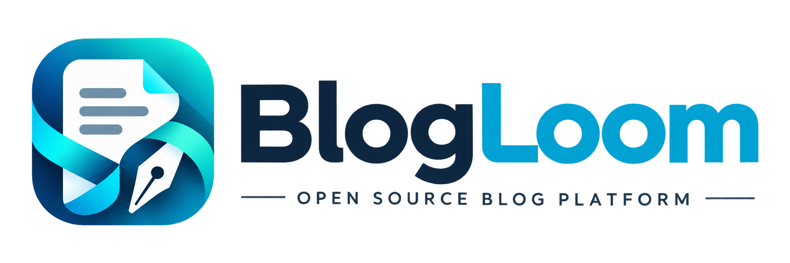
</p>

<h1 align="center">BlogLoom</h1>

<p align="center">
  An open-source blogging platform for individual developers and content creators.
</p>

<p align="center">
  <strong>English</strong> | <a href="./README.zh-CN.md">简体中文</a>
</p>

<p align="center">
  From Markdown authoring, content management and site configuration to blog presentation, comments and traffic analytics — all in one decoupled front-end / back-end system.
</p>

<p align="center">
  <a href="https://blogloom.changlu.cloud/"></a>
  <a href="https://github.com/changluya/BlogLoom/actions/workflows/ci.yml"></a>
  <a href="https://github.com/changluya/BlogLoom/releases"></a>
  
  
  
  
  
  
</p>

## Introduction

**BlogLoom** is an integrated blogging platform built with Spring Boot, MyBatis and Vue. It consists of three main parts — a public blog front end, a content management console and a back-end service — and is suitable for building a personal tech blog, an open-source project homepage, or a content platform you can keep extending.

BlogLoom focuses not only on showing articles but on the whole chain from content production to site operations:

```text
Markdown authoring → Content organization → Review & publish → Blog presentation → Comments → Traffic analytics → Ongoing maintenance
```

## Highlights

- **Decoupled architecture**: the public blog, the admin console and the REST API run and build independently.
- **Complete content loop**: article authoring, categories, tags, columns, comments, page configuration and front-end presentation.
- **Markdown writing experience**: Markdown editing, article description, table of contents, syntax highlighting and image display.
- **Local knowledge base**: manage articles with a directory tree, plus ZIP batch import/export and article metadata parsing.
- **AI Skill sync**: download a dedicated AI skill package and use natural language to import, update or query local Markdown articles — identical to the in-console import.
- **Configurable site**: site name, icon, avatar, footer, social links, friends, about page and a custom display module, all maintained in one place.
- **SEO & feeds**: public pages are server-rendered with built-in robots / sitemap / RSS and structured data, ready for search-console verification and ad platforms.
- **Operational analytics**: the console summarizes visits, unique visitors, content counts, category/tag distribution, and a global 3D visitor globe with country/city PV and UV.
- **Content safety**: deleted articles go to the recycle bin and can be restored or permanently removed.
- **Multiple image storages**: local upload and Aliyun OSS, with connectivity testing in the console.
- **One-command Docker deployment**: an all-in-one image (back end serves both front ends) plus MySQL, with command-line deploy and incremental upgrade.
- **Logs & scheduled jobs**: task, login, operation, exception and visit logs in one place.
- **Extensible by design**: a cleanly layered back end and independent front ends make theme changes or API extensions straightforward.

## Recent Updates

### 2026.09.22 – 2026.10.17 (v1.0.1)

- **SEO server-side rendering (phase 1)**: public pages such as article detail, home, tag, category, column and archive are server-rendered with Thymeleaf, adding title / description / canonical / Open Graph / JSON-LD structured data.
- **Site-level SEO files**: added `robots.txt`, `sitemap.xml` and `rss.xml`, with a configurable SEO domain and quick view/download in the console.
- **Search platform site verification**: the "SEO platform association" page injects Baidu / Bing / Google verification meta tags.
- **Monetization (Google AdSense)**: configure publisher ID, auto/manual ad slots and `ads.txt` in the console; ads are injected on both the front end and the SEO-rendered pages.
- **RSS subscription entry**: the home article list now offers an RSS entry, with mobile adaptation.
- **Reading page refinements**: a compact top navigation for article pages, adjusted width/position of the right-hand table of contents, and fixes for column backgrounds and share covers.
- **WeChat Official Account publishing skill**: added a WeChat (gzh) channel whose draft saving now polls and re-reads the result to avoid false "success".
- **Global 3D visitor globe**: a standalone page renders visitors for the selected time range (all / today / yesterday / last 7 days / custom) on a rotatable Canvas globe, with country heat, city dots scaled by UV, China/overseas Top 20 rankings, bilingual labels and 10-second auto refresh for the "today" view. The old China-only 2D map is hidden from the overview page.

### 2026.09.13 – 2026.09.22 (v1.0.0)

- **First open-source release**: a blog front end, an admin console and a Spring Boot backend covering Markdown authoring, categories and tags, archives, comments, moments, friend links and the about page, together with initialization SQL, deployment scripts and basic documentation.

## Quick Start

### One-command deployment (recommended)

Just want the blog running quickly? A **minimum of 2 vCPU / 4 GB RAM** is recommended (server and MySQL on the same host). With Docker and Docker Compose v2 installed on the server, one command is enough — no JDK / Node / Maven and no need to clone the repo:

```bash
mkdir blogloom && cd blogloom
curl -fsSL https://raw.githubusercontent.com/changluya/BlogLoom/master/docker/standalone/install.sh | bash
```

Windows PowerShell (with Docker Desktop installed and running):

```powershell
$dir = Join-Path $HOME 'blogloom'; New-Item -ItemType Directory -Force $dir | Out-Null; Set-Location $dir; curl.exe --ssl-no-revoke -fL --retry 5 'https://gitee.com/changluJava/blog-loom/raw/master/docker/standalone/windows/install.ps1' -o install.ps1; if ($LASTEXITCODE -eq 0) { powershell.exe -ExecutionPolicy Bypass -File .\install.ps1 }
```

> If the Docker Hub connection times out, the installer automatically configures a domestic registry mirror and retries.

| Entry | Address |
| --- | --- |
| Blog front end | `http://<server-ip>:18080` |
| Admin console | `http://<server-ip>:18080/cms` |
| Default account | `admin` / `123456` (change it right after login) |

**Seamless upgrade** (pull the latest version without data loss):

```bash
cd blogloom
./upgrade.sh            # resolve and upgrade to the latest version
./upgrade.sh 1.0.1      # upgrade to a specific version
```

See [docker/README.md](./docker/README.md) for details, or the author's walkthrough: [BlogLoom one-command Docker Compose deployment in practice](https://blog.changlu.cloud/blog/42).

## Feature Scope

### Blog Front End

- Home banner, site navigation, profile card and latest content
- Article list, article detail, Markdown rendering and image preview
- Browse articles by category, tag, column and archive
- In-site article search
- Moments display and likes
- Comments and replies
- Friends page, about page and a custom display module
- Responsive layout, lazy loading and back-to-top reading experience

### Admin Console

- Dashboard: visits, unique visitors, article and comment counts, category/tag distribution, visitor map
- Article authoring: Markdown editing, categories/tags, columns, description, cover and publish options
- Content management: articles, moments, categories, tags, columns and comments
- Content safety: article recycle bin (restore / permanently delete)
- Migration & organization: local knowledge-base tree, Markdown batch import/export, article backup
- AI Skill sync: download a dedicated skill package and use natural language to import, update and query local articles
- SEO: SEO domain configuration, robots / sitemap / rss / ads core files, search-console verification, ad platform association
- Page management: site settings, friends, about page and custom display module
- Image host: local / Aliyun OSS upload channel configuration and connectivity testing
- System management: account maintenance and scheduled jobs
- Log center: task, login, operation, exception and visit logs
- Visitor statistics: visit records and behavior analysis

### Back-end Service

- Spring Security + JWT admin authentication
- MyBatis data access with PageHelper pagination
- Quartz scheduled jobs
- CommonMark Markdown parsing and SEO server-side rendering (Thymeleaf)
- Comment notification and email delivery
- Local upload and Aliyun OSS upload adapter
- IP geolocation, client and referrer identification
- Unified exception handling, operation logs and layered interfaces

## Screenshots


### Blog Front End

| Home | Blog | Article | Archive | Friends | About |
| --- | --- | --- | --- | --- | --- |
| 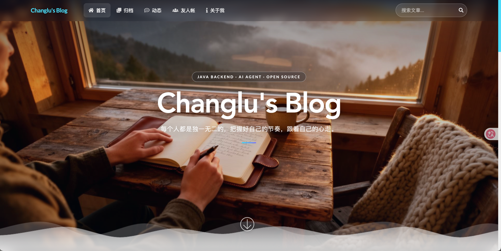 | 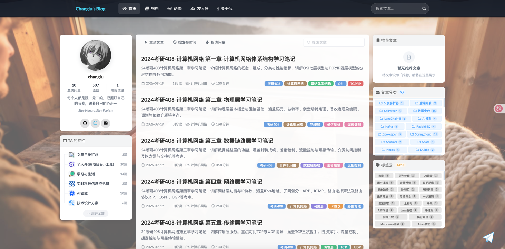 | 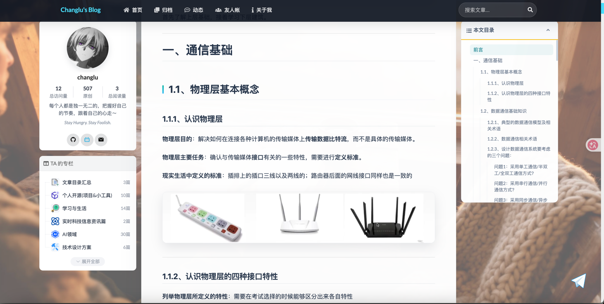 | 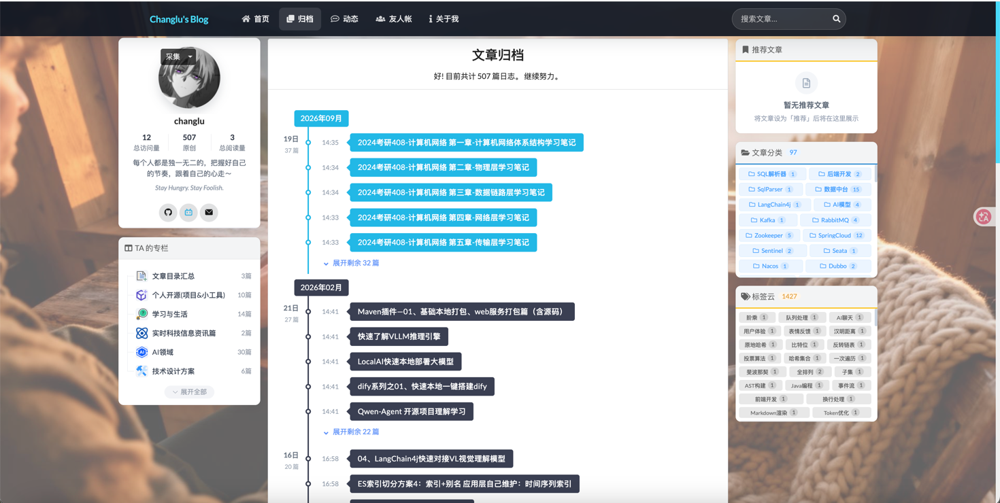 | 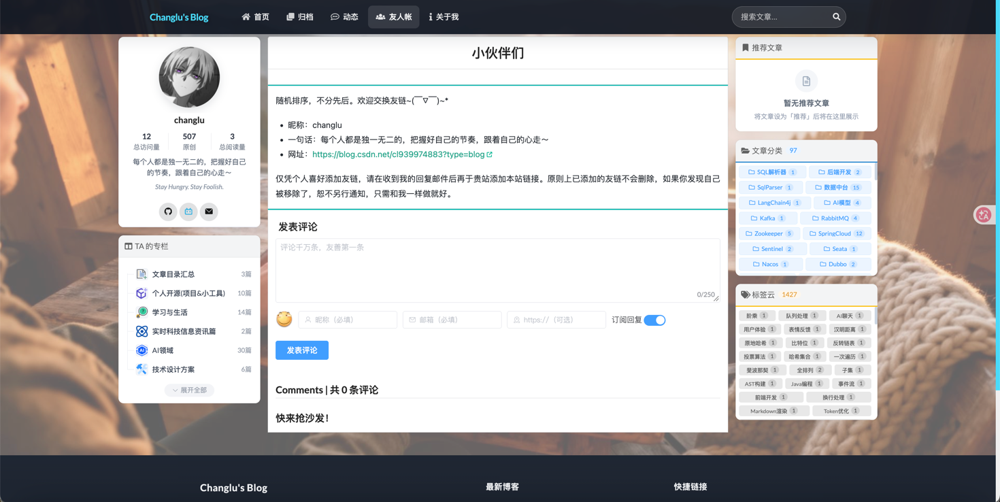 | 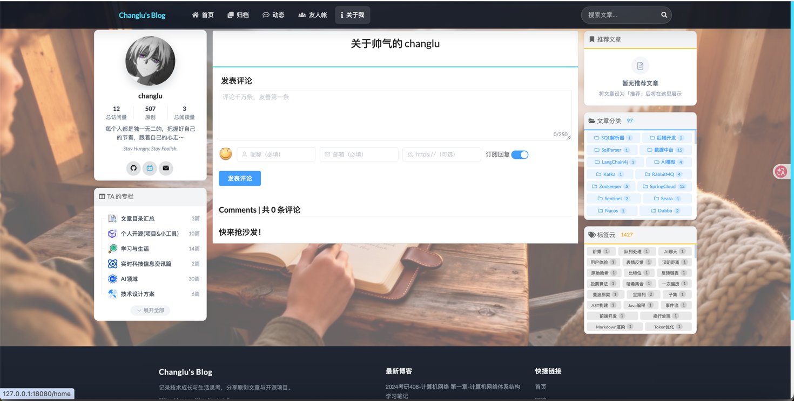 |

### Admin Console

| Dashboard | Articles | Columns | Knowledge Base | Image Host | Site Stats | Visit Log |
| --- | --- | --- | --- | --- | --- | --- |
| 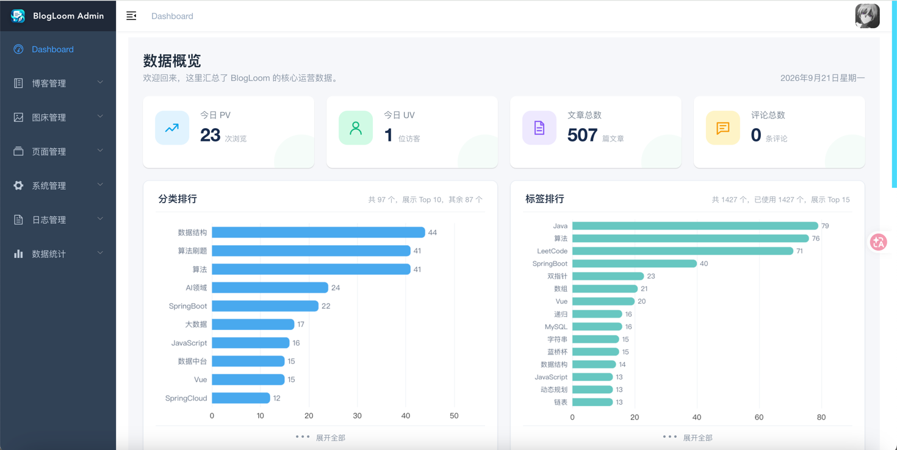 | 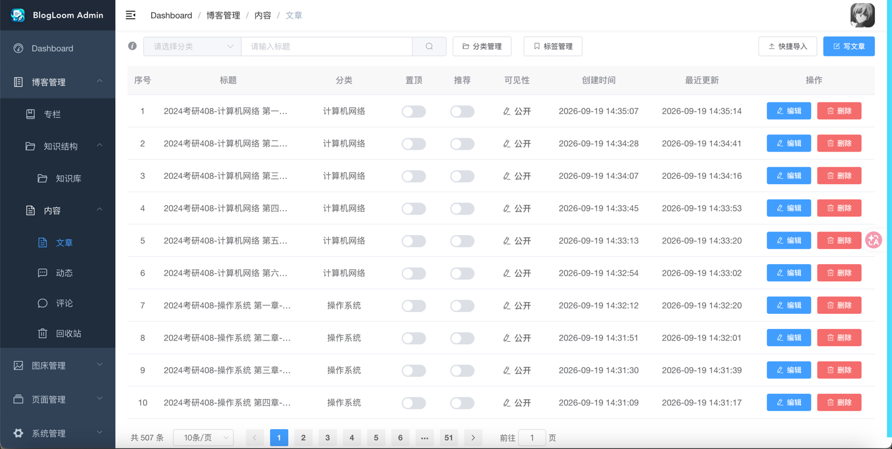 | 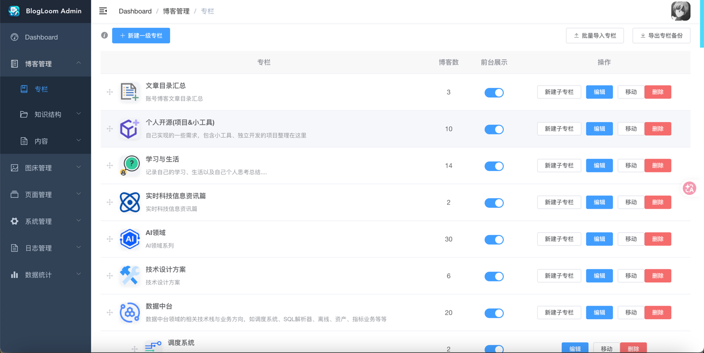 | 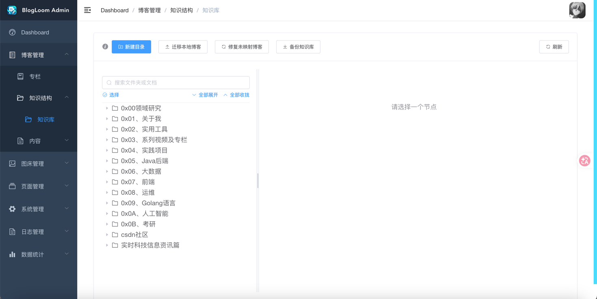 | 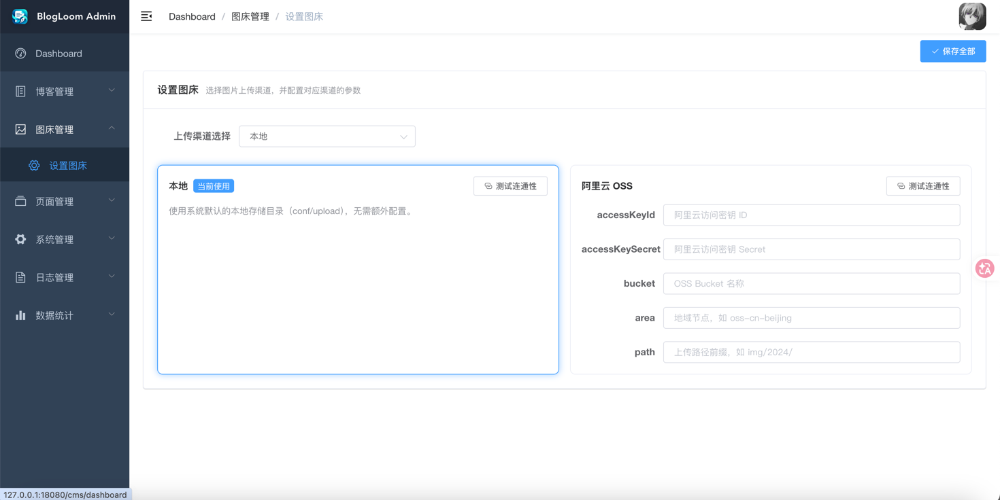 | 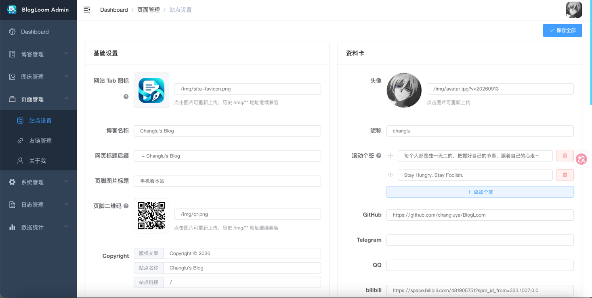 | 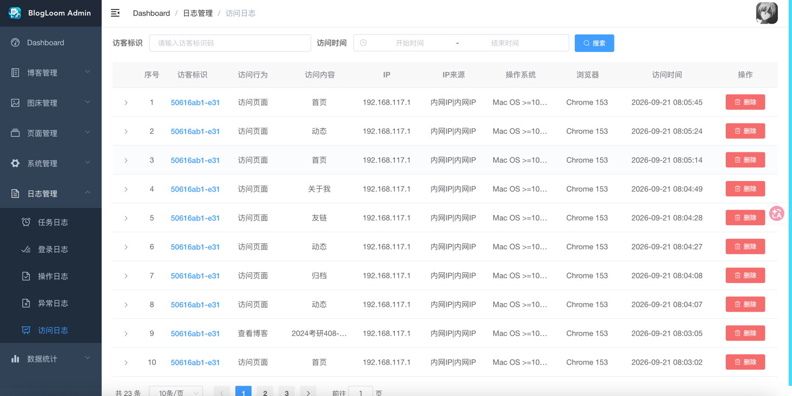 |

| SEO Settings | AdSense Settings |
| --- | --- |
| 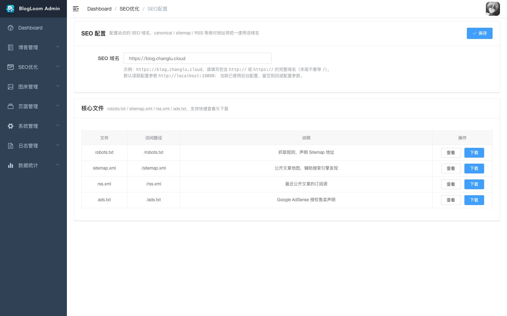 | 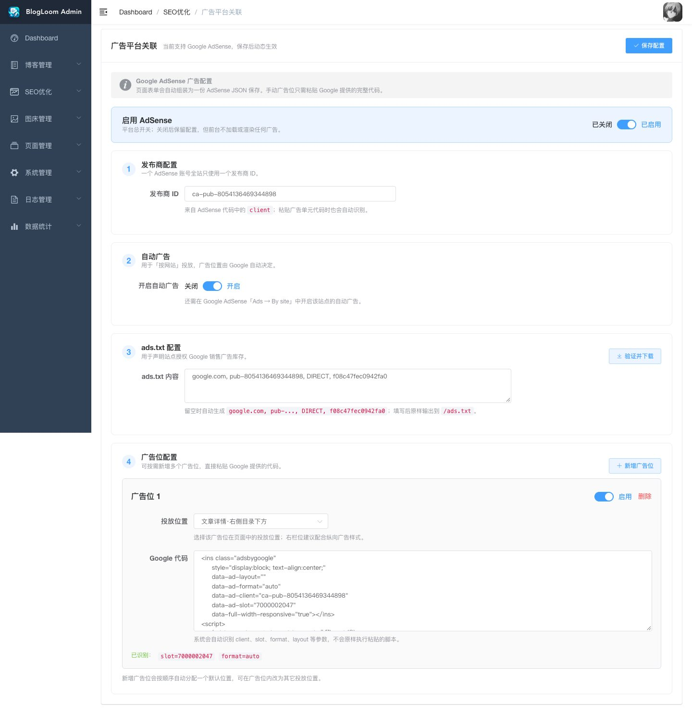 |

## Real-World Case

BlogLoom is the very blog system the author runs in production. The site below is fully powered by BlogLoom — from content authoring and site configuration to SEO and ad delivery — and serves as a real reference for how the project's capabilities land in practice:

- **Live site**: <https://blog.changlu.cloud/>
- **Practical coverage**: Markdown authoring, knowledge base organization, column aggregation, SEO server-side rendering and Google AdSense monetization all run stably online.

## System Composition

| Module | Responsibility | Default address |
| --- | --- | --- |
| `blog-view-ui` | Public blog portal, article reading and interaction | <http://localhost:8080> |
| `blog-cms-ui` | Content management and operations console for site owners | <http://localhost:8079> |
| `blog-backend` | REST API, authentication, business logic, data access and job scheduling | <http://localhost:8090> |
| MySQL | Persistent data such as business records | database `blogloom` |

```text
┌──────────────────────┐          ┌──────────────────────┐
│    blog-view-ui      │          │     blog-cms-ui      │
│  Public blog/visitor │          │ Content/operations   │
└──────────┬───────────┘          └──────────┬───────────┘
           │            REST API             │
           └──────────────┬──────────────────┘
                          ▼
               ┌──────────────────────┐
               │    blog-backend      │
               │ Spring Boot/MyBatis  │
               └──────────┬───────────┘
                          ▼
               ┌──────────────────────┐
               │        MySQL         │
               │    Business data     │
                └──────────────────────┘
```

## Tech Stack

| Area | Main technologies |
| --- | --- |
| Back-end core | Java 8, Spring Boot 2.2.7.RELEASE, Spring MVC, Thymeleaf (SEO rendering) |
| Data storage | MyBatis, PageHelper, MySQL |
| Security & jobs | Spring Security, JWT, Quartz, Spring Retry |
| Content & utilities | commonmark-java, ip2region, Yauaa, Hutool |
| Admin console | Vue 2.6.11, Vite 4.5.14, Element UI, Vuex, Vue Router, ECharts, mavon-editor |
| Blog front end | Vue 2.6.11, Vite 4.5.14, Semantic UI, Element UI, Vuex, Vue Router |
| Network & media | Axios, sanitize-html, v-viewer, vue-lazyload |

## Directory Structure

```text
BlogLoom/
├── .github/                        # CI workflows (back end and front-end builds)
├── assets/                         # README and brand assets
├── blog-backend/                   # Spring Boot back end
│   ├── src/main/java/com/changlu/blogloom/
│   │   ├── controller/             # Public and admin REST endpoints
│   │   ├── service/                # Business services and implementations
│   │   ├── mapper/                 # MyBatis mapper interfaces
│   │   ├── entity/                 # Database entities
│   │   ├── model/                  # DTOs and VOs
│   │   ├── module/                 # Knowledge base, column, SEO, cache modules
│   │   ├── config/                 # Security, web, static resource config
│   │   ├── task/                   # Scheduled jobs
│   │   └── util/                   # Markdown, upload, notification utilities
│   ├── src/main/resources/         # Config, mapper XML, SEO templates and static resources
│   └── pom.xml
├── blog-cms-ui/                    # Vue admin console
├── blog-view-ui/                   # Vue public blog front end
├── sql/
│   └── increment/                  # Incremental SQL (including full baseline)
│       └── 1.0/                    # 1.0 database scripts
├── conf/                           # External config, logs and local upload directory
├── docker/                         # One-command Docker deployment (image, compose, scripts, end-user bundle)
├── qa/                             # Stress and capacity testing scripts
├── docs/                           # Product and design documents
│   └── releases/                   # Release notes archive
├── docs-website/                   # Documentation website
├── bin/                            # Local incremental upgrade scripts
├── CHANGELOG.md                    # Changelog
├── LICENSE                         # MIT License
├── README.md                       # English documentation (default)
└── README.zh-CN.md                 # Chinese documentation
```

## Local Development

Requirements: JDK 8+, Maven 3.6+, Node.js 16+ with npm, MySQL 5.7+ or MySQL 8.

**1. Initialize the database**

Create the database:

```sql
CREATE DATABASE blogloom
  CHARACTER SET utf8mb4
  COLLATE utf8mb4_unicode_ci;
```

Configure the connection and run the incremental SQL — the first run performs a full initialization (including the baseline):

```bash
cp bin/local/deploy.conf.example bin/local/deploy.conf   # fill in the DB connection
./bin/local/upgrate-sql.sh
```

**2. Start the back end**

Adjust `blog-backend/src/main/resources/application-dev.properties` as needed (database, `token.secretKey`, `blog.api`/`blog.cms`/`blog.view`, etc.), then:

```bash
cd blog-backend
mvn spring-boot:run
```

Default port is `8090`. Never commit the database password, token secret, mail authorization code or object-storage keys.

**3. Start the admin console**

```bash
cd blog-cms-ui
npm install
npm run dev
```

Defaults to <http://localhost:8079>; the API base URL is controlled by `VITE_API_URL` in `.env.development`.

**4. Start the blog front end**

```bash
cd blog-view-ui
npm install
npm run dev
```

Defaults to <http://localhost:8080>; the API base URL is controlled by `VITE_API_URL` in `.env.development`.

## Default Admin Account

After the full SQL initialization, the default console account is:

```text
Username: admin
Password: 123456
```

Change the default password right after the first login, and generate a sufficiently long and random `token.secretKey` for production.

## Roadmap

- [ ] Upgrade to a modern JDK and Spring Boot version
- [ ] Migrate the admin console to Vue 3, TypeScript and a new component system
- [x] Improve SEO, Sitemap and RSS (phase 1: server-side rendering + robots/sitemap/rss + search-console verification)
- [ ] Add SSR/SSG capabilities to the front end
- [ ] Build a configurable theme and page system
- [ ] Support multi-site management
- [ ] Extend multi-channel publishing to CSDN, Juejin, cnblogs and more
- [ ] Enhance unified media resource management
- [ ] Introduce AI-assisted writing, summarization and content organization
- [x] Provide a Docker Compose one-command deployment (see [docker/README.md](./docker/README.md))

> The above is an evolution roadmap and does not imply the current version already implements it.

## Contributing

Issues for problems, suggestions or feature requests are welcome, as are pull requests. See [CONTRIBUTING.md](./CONTRIBUTING.md) for the full workflow and conventions. Before submitting code, it is recommended to:

1. Verify that each affected module builds successfully.
2. When the database schema or seed data changes, keep the full SQL and the necessary incremental SQL in sync.
3. Do not commit local logs, uploaded files, real credentials or access keys.
4. Clearly state the affected modules, how you verified, and any compatibility notes in the change description.

If you find a security vulnerability, please do not open a public issue — report it privately per [SECURITY.md](./SECURITY.md).

## Contact

If this project helps you, or you have better ideas, feel free to reach out on WeChat.

Please mention your purpose when adding me (e.g. "BlogLoom").

<p align="center">
  
</p>

## Credits

BlogLoom is a derivative work based on [Naccl/NBlog](https://github.com/Naccl/NBlog). Thanks to Naccl and all NBlog contributors for the excellent open-source foundation, and to Spring Boot, Vue, MyBatis, Element UI, Semantic UI and the other open-source projects used here.

## License

BlogLoom is released under the [MIT License](./LICENSE), retaining the copyright and license notices required by the original project.
