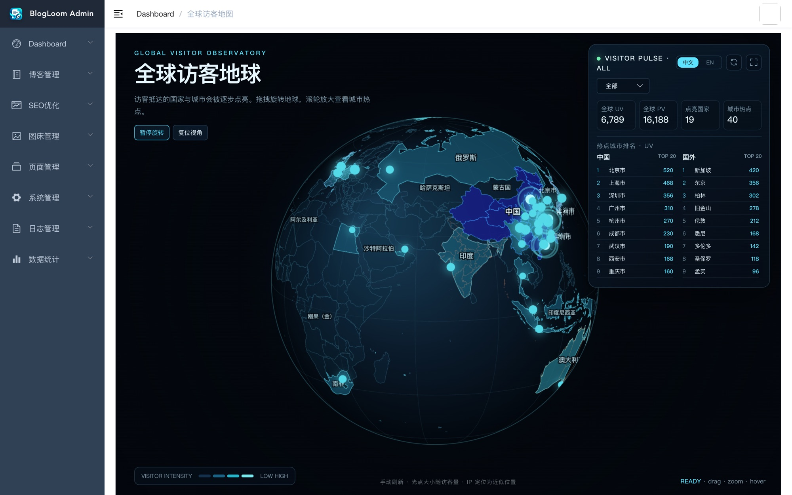
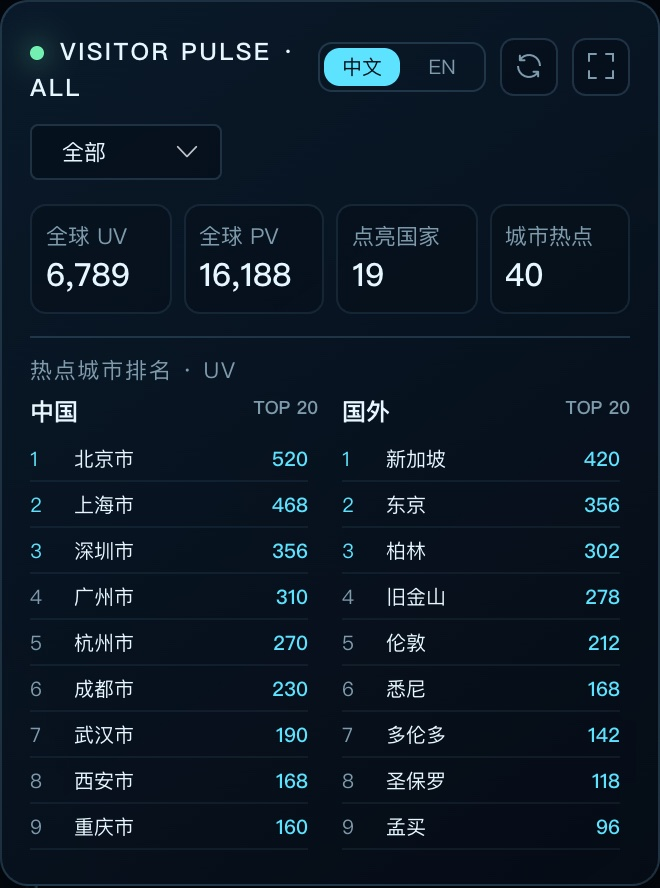

# 从中国城市散点到 3D 全球访客地球：BlogLoom 访客地图的设计与实现

## 一、历史背景设计与现状拆解

> 调研分支：`feat_1.0.x_9`<br />
> 调研日期：2026-10-16<br />
> 本章只回答存量地图“用了什么技术、按什么思路设计、数据落在哪些表、能展示多大范围”，作为后续全球化方案的现状基线；全球 3D 访客地球的落地设计见第二章。

### 1.1 历史来源与演进

BlogLoom 的后台访客地图不是为全球化从零设计的，而是沿用了项目早期的“中国城市访客分布”方案。这套能力在项目初期就已存在，包括仪表盘地图、`city_visitor` 表、每日访客同步任务和 `city2coord.json` 坐标字典，后续迭代主要围绕工程结构、后台布局和仪表盘聚合展开，地图本身没有发生方向性变化。

设计原点可以概括为一句话：

> 用离线 IP 库把访问者 IP 解析为中国城市；每天凌晨把“昨日新增访客”的城市 UV 累加到城市汇总表；后台仪表盘读取城市汇总，并在中国地图上绘制普通散点和 Top 5 动效散点。

这里的“历史存量”指已有的累计城市访客数据和访问日志，不指已经具备按日期回放能力的历史地图快照：`city_visitor` 没有日期字段，只能表达“累计到当前”的城市 UV。

> 现状补充：该地图当前已从“数据概览”页面隐藏，但 `city_visitor`、每日聚合任务和 `/admin/dashboard` 返回链路仍然保留，后续可对照旧口径或按需恢复。

### 1.2 核心技术栈

**前端（`blog-cms-ui`）**

| 层次 | 技术/版本 | 在地图中的作用 |
| --- | --- | --- |
| 前端框架 | Vue `2.6.11` | 单文件组件中请求数据、初始化与销毁图表 |
| 构建工具 | Vite `4.5.14` + `vite-plugin-vue2` | CMS 开发与构建 |
| UI 框架 | Element UI `2.13.2` | `el-row`/`el-col`/`el-card` 负责布局，不参与绘制 |
| 图表引擎 | ECharts `4.9.0` | 地图底图、地理坐标系、散点、动效与 Tooltip |
| 地图底图 | `echarts/map/js/china` | ECharts 4.x 内置中国地图，注册为 `map: "china"` |
| 坐标字典 | `src/util/city2coord.json` | 城市名 → `[经度, 纬度]`，共 362 个中国城市 |
| 渲染器 | Canvas（默认） | 调用 `echarts.init(dom)`，未指定 SVG |

**后端与数据（`blog-backend`）**

| 层次 | 技术/版本 | 在地图中的作用 |
| --- | --- | --- |
| 运行环境 | Spring Boot `2.2.7.RELEASE` / Java 8 | 后台接口与定时任务 |
| 持久层 | MyBatis + PageHelper | 访问日志、访客档案、聚合表读写 |
| 数据库 | MySQL | 明细、档案、日聚合、城市累计、缓存集合 |
| 埋点 | Spring AOP + `@VisitLogger` | 业务接口正常返回后记录访问日志 |
| 异步 | Spring `@Async` | 日志落库不阻塞业务响应 |
| IP 地域库 | ip2region `3.3.7`（离线 XDB） | IP → `国家\|省\|城市\|运营商\|ISO 国家码` |
| 终端解析 | yauaa `7.11.0` | 解析操作系统与浏览器 |
| 定时调度 | Quartz（`schedule_job`） | 每天 `0 0 0 * * ?` 执行访客同步任务 |
| 缓存 | 自建 `cache_entry` 表 | 替代 Redis，保存当日 `identificationSet` 等集合 |

### 1.3 相关设计思路

存量地图采用“**明细采集 → 离线聚合 → 累计展示**”三段式设计，而不是直接对访问日志做实时地理查询。

```text
业务接口（@VisitLogger）
  → VisitLogAspect：识别访客 UUID、组装 URI/IP/UA/行为
  → VisitLogServiceImpl（@Async）：ip2region 解析 ip_source，补 OS/浏览器
  → visit_log：一次被埋点请求一行（明细事实）

每天 00:00 Quartz：VisitorSyncScheduleTask
  ├→ 昨日 visit_log 行数          → visit_record.pv
  ├→ 昨日 visit_log 按 UUID 去重  → visit_record.uv
  ├→ 按 UUID 汇总 PV/最后访问时间 → visitor.pv / last_time
  └→ 昨日新增 visitor 中的中国城市 → city_visitor.uv（累加）

后台读取：GET /admin/dashboard
  → cityVisitor: [{ city, uv }]（按 uv desc）
  → 前端 city2coord.json：城市名 → [lng, lat]
  → ECharts geo + map + scatter + effectScatter 绘制
```

四个关键设计取舍：

| 取舍 | 具体做法 | 带来的结果 |
| --- | --- | --- |
| 地域解析离线化 | 启动时把 ip2region XDB 全量加载进内存，不调用外部 IP 服务 | 查询稳定、无网络依赖；精度取决于离线库版本 |
| 统计离线聚合 | 每天凌晨把昨日明细汇总成日记录和城市累计值 | 仪表盘查询简单；代价是地图数据最多滞后一天 |
| 城市名作为连接键 | `ip_source` 第三段城市名 → `city_visitor.city` → `city2coord` 的 key | 实现简单；名称必须完全一致，且无法区分同名城市 |
| 展示与统计解耦 | 后端只返回 `{city, uv}`，坐标和视觉全部在前端决定 | 前端可独立调整样式；也导致坐标字典只覆盖中国 |

另外两点工程约定：

1. **身份识别**：请求头 `identification` 携带 UUID；没有时由“小时时间戳 + IP + User-Agent”生成确定性 UUID 并写回响应头。当前 UV 依赖 `cache_entry` 中的 `identificationSet:<uuid>` 集合去重。
2. **地图不是实时流**：页面没有 WebSocket、SSE 或定时轮询，只在组件挂载时请求一次 `/admin/dashboard`；所谓“实时分布”只是文案。

### 1.4 核心名词与统计口径

| 名词 | 含义 | 本项目中的口径 |
| --- | --- | --- |
| PV | Page View，访问量 | `visit_log` 中被埋点接口的请求行数；今日 PV = `date(create_time)=curdate()` 的 `count(*)` |
| UV | Unique Visitor，独立访客数 | 按 UUID 去重后的数量；今日 UV 取 `identificationSet` 集合成员数 |
| UUID / `identification` | 访客标识 | 由“小时时间戳 + IP + UA”生成的确定性 UUID，通过响应头下发，前端后续请求回传 |
| `ip_source` | IP 地域文本 | ip2region 解析结果，新数据为五段：`国家\|省\|城市\|运营商\|ISO 国家码`，历史数据可能只有四段 |
| 城市 UV | 城市维度的新增访客数 | 每日任务把“昨日新建访客档案”按中国城市累加到 `city_visitor.uv` |
| 日 UV | 自然日维度的独立访客数 | 昨日 `visit_log.uuid` 去重后写入 `visit_record.uv` |
| 累计 UV | 建站以来累加值 | `city_visitor.uv` 只增不减，没有日期字段 |
| `geo` 坐标系 | ECharts 地理坐标系 | 散点系列共用的经纬度坐标系，底图由 `map: "china"` 提供 |
| `scatter` | 普通散点系列 | 绘制全部有坐标的城市，点大小固定为 5 |
| `effectScatter` | 动效散点系列 | 绘制 UV Top 5 城市，半径 12、带波纹并直接显示城市名 |
| `city2coord` | 前端城市坐标字典 | 362 个中国城市的“名称 → `[lng, lat]`”映射，名称不匹配则跳过该城市 |
| Top 5 | UV 最高的 5 个城市 | 后端按 `uv desc` 返回全部城市，前端取数组前 5 项，不是独立的 TopN 查询 |

### 1.5 核心表设计

存量地图围绕五张表工作，职责划分如下：

```text
visit_log（访问明细，一次请求一行）
   │  按 uuid 关联
   ├──────────────► visitor（访客档案，一个 UUID 一行）
   │                   │ 每日新增档案按 ip_source 城市聚合
   │                   ▼
   │                city_visitor（城市累计 UV，city 为主键）
   │
   └── 每日按日期聚合 ──► visit_record（每日 PV/UV，date 为字符串）

cache_entry（键值缓存）── identificationSet:<uuid> ──► 今日 UV 去重
```

**① `visit_log`：访问明细事实表**

| 字段 | 类型 | 说明 |
| --- | --- | --- |
| `id` | bigint PK | 自增主键 |
| `uuid` | varchar(36) | 访客标识，UV 去重依据 |
| `uri` / `method` / `param` | varchar | 请求路径、方法、参数 |
| `behavior` / `content` / `remark` | varchar | 访问行为及业务描述 |
| `ip` / `ip_source` | varchar(255) | 客户端 IP 与 ip2region 地域文本 |
| `os` / `browser` / `user_agent` | varchar | 终端信息 |
| `times` | int | 请求耗时（毫秒） |
| `create_time` | datetime | 访问时间，PV 与日聚合的时间依据 |

原始建表只有主键索引；后续全球地图增量才补充 `is_page_view`、`geo_id`、`geo_status` 和组合索引，这些字段不属于旧地图的统计口径。

**② `visitor`：访客档案表**

| 字段 | 说明 |
| --- | --- |
| `uuid` | 唯一键 `idx_uuid`，一个访客一行 |
| `ip` / `ip_source` | 首次访问时的 IP 与地域 |
| `os` / `browser` / `user_agent` | 首次访问终端信息 |
| `create_time` / `last_time` | 首次、最后访问时间 |
| `pv` | 该访客累计访问页数 |

城市地图只使用其中“昨日新建、且 `ip_source` 为中国城市”的档案。

**③ `visit_record`：每日 PV/UV 聚合表**

| 字段 | 说明 |
| --- | --- |
| `pv` | 当日访问日志行数 |
| `uv` | 当日 UUID 去重数 |
| `date` | 日期字符串（`MM-dd`），不是日期类型 |

**④ `city_visitor`：城市累计 UV 表**

| 字段 | 说明 |
| --- | --- |
| `city` | 城市名，主键，同时是展示名和坐标字典 key |
| `uv` | 累计新增访客数 |

写入使用 `INSERT ... ON DUPLICATE KEY UPDATE uv = uv + #{uv}`，只做加法；表里没有日期、国家码、行政区码或经纬度，因此无法按时间切片，也无法稳定关联同名城市。

**⑤ `cache_entry`：缓存表（替代 Redis）**

| 字段 | 说明 |
| --- | --- |
| `cache_key` | 唯一键，例如 `identificationSet:<uuid>` |
| `cache_value` | 缓存值（JSON/文本） |
| `cache_type` / `expire_time` | 缓存类型与过期时间 |

今日 UV 通过 `countBySet("identificationSet")` 统计集合成员数；每日任务开始时清空该集合，再由当天请求逐步重建。

### 1.6 地图展示范围

存量地图的展示范围可以按“空间、时间、数值、交互、页面位置”五个维度界定：

| 维度 | 当前范围 | 代码依据 |
| --- | --- | --- |
| 空间底图 | 仅中国地图，使用 ECharts 内置 `china` 底图，绘制省界与中国轮廓 | `geo.map="china"`、`map: "china"` |
| 统计范围 | 仅 `ip_source` 第一段为“中国”、且第三段城市非空非 `0` 的记录 | `VisitorSyncScheduleTask` 的城市聚合判断 |
| 地理粒度 | 城市级；没有国家、省份聚合，也没有国家码 | `city_visitor` 只有 `city`、`uv` |
| 坐标覆盖 | 362 个中国城市；查不到坐标的城市静默跳过 | `city2coord.json`、`convertData()` |
| 时间范围 | 累计值，每天 00:00 增量更新；不支持按日/周/月回放 | `city_visitor` 无日期字段 |
| 数值含义 | 城市累计新增访客 UV，不是 PV，也不等于自然人数 | 任务按昨日新建 `visitor` 计数 |
| 视觉编码 | 全部城市固定半径 5 的青色散点；Top 5 半径 12 带波纹并显示城市名；UV 只在 Tooltip 中 | `scatter` / `effectScatter` 配置 |
| 交互范围 | 固定视角 `center=[104.2, 36]`、`zoom=1.24`、`roam=false`；不可拖动、缩放或下钻 | `mapOption.geo` |
| 页面位置 | 原本内嵌在数据概览 `/dashboard`，与 PV/UV、分类/标签排行、近七日趋势同页 | `views/dashboard/index.vue` |

地图能回答与不能回答的问题：

| 能回答 | 不能回答 |
| --- | --- |
| 国内哪些城市累计访客最多 | 有没有海外访客、来自哪些国家/城市 |
| 各城市历史累计 UV 的相对高低 | 最近 24 小时或某一天的城市分布 |
| 哪些城市进入 Top 5 | 某城市某天的 UV 是多少（无法回放） |
| 站点整体累计访问概况 | 省份/国家汇总、访客迁移轨迹、精确自然人数 |

因此，旧地图本质上是一张“**中国城市累计访客排行图**”，而不是全球、实时、可回放的地理观测系统。

---

## 二、全球化 3D 访客地球：目标、产品设想与技术设计

> 本章回答三个问题：**要做成什么**（目标与产品设想）、**用什么做**（技术栈重新选型）、**怎么做**（前后端拆分、表设计与演进路线）。
> 设计原则：先定义口径，再定义接口，最后才定义视觉；任何视觉表现都不能反过来修改统计事实。

### 2.1 目标：从“中国城市排行”到“全球访客观测台”

#### 2.1.1 旧地图为什么不够用

旧地图能回答“国内哪些城市累计访客最多”，但回答不了“昨天有没有人从柏林来”。这不是换一张世界地图就能解决的，四个限制卡在数据链路上：

| 限制 | 旧实现 | 产品后果 |
| --- | --- | --- |
| 空间范围 | 聚合只处理 `ip_source` 以“中国”开头的记录 | 海外访客永远不出现 |
| 时间维度 | `city_visitor` 无日期字段，只有累计值 | 看不到最近 24 小时，也无法回放 |
| 地域粒度 | 城市名既是展示名又是主键 | 同名城市、英文城市名无法稳定关联 |
| 实时性 | 每日凌晨任务更新 | 页面写着“实时”，数据却是昨天的 |

所以要做的是**换一条数据链路**，而不是换一张底图。

**旧地图如下**：显示的范围就是中国内的

  

#### 2.1.2 这个页面给站长看什么

整个方案的核心思路其实就三句话：

1. **把 IP 变成标准地点**：每条访问日志都记下它属于哪个国家、哪个城市，而不是只存一串 IP 文本。
2. **按所选时间范围实时计算**：不依赖累计表，每次查询都按时间窗口重新聚合，所以“今日”看到的就是现在。
3. **把结果画在地球上**：城市是一个个光点，点越大访客越多，一眼就能看出热点在哪。

说白了，这个页面就是回答四个很具体的问题：

| 站长的问题 | 页面怎么回答 |
| --- | --- |
| 有没有外国人看我的博客？ | 地球上直接出现海外光点，右上角有“国家数” |
| 最近一天到底来了多少人？ | 右上角选“今日”或“昨日”，显示对应范围的 PV / UV |
| 现在哪里最热？ | 光点越大代表访客越多，右边有中国/国外 Top 20 榜单 |
| 是海外读者多还是国内多？ | 两个榜单分开列，一眼能对比 |

**和旧地图的差别，用一句话说清：**

- 旧地图回答的是“北京历史上累计来过多少人”——一个只增不减的总数。
- 新地图回答的是“昨天有没有人从柏林来”——可以按全部/今日/昨日/前 7 天/自定义切片查看。

**怎么判断这个页面做成了：**

1. 打开页面不用点任何按钮，3 秒内就能看到数字和地球。
2. 有海外访问时，海外国家和城市真的会出现，而不是永远只有中国。
3. 页面上的数字拿一条 SQL 就能算出来，对不上就是 bug。
4. 页面放着不动，数字会自己更新；刷新时地球不会突然跳回初始角度。
5. 地图是空的时候，能说清是“真的没人访问”“IP 没解析出来”还是“城市字典没收录”。

**这期故意不做的事，以及为什么：**

| 不做 | 原因 |
| --- | --- |
| 统计“真实人数” | IP + 浏览器标识只能近似，硬说人数会误导 |
| 逐日回放、轨迹动画 | 时间范围只是区间查询，不等于能按天回放地图状态 |
| 街道级定位 | IP 定位本身就只到城市，再细是假精度 |
| WebGL / Three.js | 几百个点的数据量，Canvas 2D 足够，不想为“3D”多背一个运行时 |
| 新增预聚合表 | 现在日志量用索引就能扛住，提前聚合反而多一层口径要维护 |
| 接口返回 IP / UUID | 后台页面不需要，返回了只会增加泄露风险 |

### 2.2 产品层面设计

#### 2.2.1 产品定位与页面关系

新产品不是“旧地图美化”，而是**以访问日志为事实源的独立观测页**，与旧数据概览并行、互不替代：

```text
后台 Layout
└── Dashboard（父级菜单）
    ├── /dashboard/overview           数据概览（旧二维中国地图，可保留/隐藏）
    └── /dashboard/global-visitor-map 全球访客地图（本期新增）
```

约束：`/dashboard` 重定向到 `/dashboard/overview`，保证旧书签不失效；新页面支持刷新直达；新页面只能通过 `/admin/visitor-map/global` 取数，不读取 `city_visitor` 或前端静态数据作为正式数据源。

#### 2.2.2 信息架构与页面布局

```text
┌──────────────────────────────────────────────────────────────┐
│  [左上] 标题区                    [右上] 统计面板             │
│  GLOBAL VISITOR OBSERVATORY        ● VISITOR PULSE · ALL     │
│  全球访客地球                       [中文|EN] [刷新] [全屏]    │
│  说明文案                           [时间范围 ▾]              │
│  [暂停旋转] [复位视角]              UV / PV / 国家 / 城市      │
│                                     热点城市 · UV            │
│            中央：3D 地球             中国 Top20 | 国外 Top20  │
│                                                              │
│  [左下] 图例                      [右下] 运行状态             │
│  VISITOR INTENSITY                READY · drag · zoom · hover│
│  [底部居中] 自动刷新 10 秒 · 光点大小随访客量 · IP 近似定位    │
└──────────────────────────────────────────────────────────────┘
```

| 区块 | 位置 | 设计意图 |
| --- | --- | --- |
| 标题区 | 左上 | 品牌感与页面定位，不遮挡地球 |
| 统计面板 | 右上 | 时间范围选择 + 四项核心指标 + 榜单，玻璃拟态浮层 |
| 地球画布 | 全屏铺满 | 视觉主体，中心略偏右给面板留白 |
| 图例 | 左下 | 解释热度色阶 |
| 运行状态 | 右下 | `LIGHTING / READY / FOCUS / ERROR`，让状态可解释 |
| Tooltip | 跟随鼠标 | 只对“有数据”的城市/省份出现 |

视觉基调为深空蓝黑 + 青色高亮：面板 `rgba(7,18,31,.82)`，强调色 `#5de3ff`，标题 40px、面板标题 12px、指标 16px。响应式上，≤1000px 收窄标题与榜单，≤720px 把统计面板移到底部并隐藏运行状态。

统计面板内的**时间范围选择器**位于标题栏下方，紧贴指标卡片：

| 选项 | 传给后端的 `periodType` | 时间窗口 | 是否自动刷新 |
| --- | --- | --- | --- |
| 全部（默认） | `all` | 不设边界，统计全部历史 | 否 |
| 今日 | `today` | 本地时区当日 00:00 → 现在 | 是，每 10 秒 |
| 昨日 | `yesterday` | 本地时区昨日 00:00 → 今日 00:00 | 否 |
| 前 7 天 | `last_7d` | 本地时区 6 天前 00:00 → 现在（含今日共 7 天） | 否 |
| 自定义 | `custom` | 开始日期 00:00 → 结束日期次日 00:00 | 否 |

选择“自定义”时，选择器右侧展开两个日期输入框（`yyyy-MM-dd`），两个日期都选好后才会发起请求；范围上限 366 天，开始日期不能晚于结束日期，非法参数由后端返回 400。

为什么只有“今日”自动刷新：只有当日数据在持续增长，全部/昨日/前 7 天/自定义都是稳定区间，每 10 秒重复查询只会浪费数据库。切到其他范围时定时器停止，底部说明文案同步从“自动刷新 10 秒”变成“手动刷新”。

#### 2.2.3 交互设计

| 操作 | 行为 | 参数 |
| --- | --- | --- |
| 拖拽 | 水平改变 yaw，垂直改变 pitch | `yaw += dx * 0.008`；pitch 限制 ±1.1 |
| 滚轮 | 缩放 | 范围 0.72–2.25 |
| 悬停有数据城市 | 显示中英文名与 UV | 命中半径 28px，仅正面（`z > 0`） |
| 悬停无数据城市 | 不弹 Tooltip，只高亮所在省份 | 避免“0 访客”噪音 |
| 点击城市 | 聚焦并放大 | 命中半径 32px，`zoom = 1.55` |
| 自动旋转 | 无操作时缓慢自转，可暂停 | `yaw += 0.0024`/帧 |
| 复位视角 | 回到初始 yaw/pitch/zoom | — |
| 页面隐藏 | 暂停绘制与轮询 | `document.hidden` |

刷新规则：切换时间范围立即重新查询；“今日”模式下每 10 秒自动刷新，页面恢复可见立即补一次；手动刷新与自动刷新复用同一方法；刷新中按钮禁用；**刷新只替换数据，不重置视角、不重播点亮动画**；失败时保留旧数据并标记。

状态机：

```text
BOOTING ──首屏成功──> READY
   │                    │
   │ 首屏失败（生产）    │ 刷新失败（有旧数据）
   ▼                    ▼
 ERROR               READY（保留旧数据，标记失败）
```

#### 2.2.4 功能清单

| 编号 | 需求 | 优先级 |
| --- | --- | --- |
| FR-01 | 展示所选时间范围内的全球 PV/UV/国家数/城市数，默认“全部” | P0 |
| FR-02 | 地球按国家热度着色、按城市 UV 绘制光点 | P0 |
| FR-03 | 光点大小随访问量级变化并有上限 | P1 |
| FR-04 | 悬停显示中英文城市名与 UV | P0 |
| FR-05 | 点击城市聚焦并放大 | P1 |
| FR-06 | 拖拽旋转、滚轮缩放、暂停旋转、复位视角 | P0 |
| FR-07 | 中国/国外双榜单 Top 20 | P0 |
| FR-08 | 中英文切换 | P1 |
| FR-09 | 全屏展示 | P2 |
| FR-10 | “今日”范围每 10 秒自动刷新；任意范围可手动刷新；刷新不打断浏览 | P1 |
| FR-11 | 加载/空/错误态可区分 | P0 |
| FR-12 | 数据质量指标可解释空地图 | P1 |
| FR-13 | 时间范围切换：全部 / 今日 / 昨日 / 前 7 天 / 自定义 | P0 |

### 2.3 数据口径与指标定义

唯一事实源是 `visit_log`；`visitor`、`city_visitor`、`visit_record` 都不作为全球地图的统计来源。

```text
PV      = 周期内 is_page_view = 1 的 visit_log 行数
全球 UV = COUNT(DISTINCT uuid)          -- 周期内 is_page_view = 1
国家 UV = COUNT(DISTINCT uuid) GROUP BY country_code
城市 UV = COUNT(DISTINCT uuid) GROUP BY geo_id (geo_level = 2)
```

| 规则 | 说明 |
| --- | --- |
| 分层去重 | 全球 UV ≠ 国家 UV 之和；国家 UV ≠ 城市 UV 之和 |
| 跨城市访客 | 全球只算 1，两个城市各算 1 |
| 时间窗口 | 默认 `all`（不设边界）；其余为 `today` / `yesterday` / `last_7d` / `custom` / 兼容的 `rolling_24h`，窗口均左闭右开 |
| 时区 | 自然日边界按 `timezone` 计算；`meta` 时间字符串同样按该时区格式化 |
| PV 口径 | 由 `VisitBehavior.pageView` 在写入时固化，不依赖中文文案 |

数据质量三指标，三者之和等于周期内 PV：

| 字段 | 含义 | 口径 |
| --- | --- | --- |
| `resolvedPv` | 命中城市级 | `geo_level = 2` 且 `geo_status = 1` |
| `countryOnlyPv` | 仅到国家级 | `geo_level = 1` 且 `geo_status = 1` |
| `unknownPv` | 未知/内网/无效 | `geo_status != 1 OR geo_id IS NULL` |

与旧仪表盘允许数字不一致，但页面必须避免让用户误以为是同一口径：

| 指标 | 旧 `/admin/dashboard` | 新全球地图 |
| --- | --- | --- |
| PV | 自然日 `COUNT(*)` | 所选范围且 `is_page_view = 1` |
| UV | 缓存集合成员数 | `COUNT(DISTINCT uuid)` |
| 地域 | 中国城市累计 | 全球国家/城市 |
| 时间 | 固定自然日 | 全部 / 今日 / 昨日 / 前 7 天 / 自定义 |

### 2.4 核心技术栈重新选型

> 本节只讨论**这张地图本身**要用的技术：怎么把地球画出来、底图从哪来、IP 怎么变成坐标、光点怎么编码、数据怎么聚合与刷新。全站框架（Vue / Spring Boot）不在本节范围，避免把“地图选型”写成“全站升级清单”。
> 版本核对时间：2026-10，来源为 npm registry 与 Maven Central。

#### 2.4.1 地图需要做哪些技术决策

一张能转、能看、能解释的地球，拆开只有六个决策点：

| 决策点 | 要解决的问题 | 对应小节 |
| --- | --- | --- |
| 渲染方式 | 用 WebGL 还是 2D Canvas 画球面 | 2.4.2 |
| 球面投影 | 经纬度怎么变成屏幕坐标、背面怎么剔除 | 2.4.3 |
| 底图数据 | 国家边界、中国省界、海外省州从哪来 | 2.4.4 |
| 坐标来源 | IP 怎么变成国家/城市，城市怎么变成经纬度 | 2.4.5 |
| 视觉编码 | 访客数量怎么映射成点的大小与颜色 | 2.4.6 |
| 数据供给 | 数据从哪张表算、多久刷一次 | 2.4.7 |

#### 2.4.2 渲染方式：Canvas 2D 而不是 WebGL

| 方案 | 版本 | 画球的方式 | 优势 | 代价 | 结论 |
| --- | --- | --- | --- | --- | --- |
| **Canvas 2D 自绘** | 浏览器原生 | 单位球向量 → 旋转 → 正交投影 → 2D 路径 | 零新增依赖；背面剔除、裁剪、标签全部可控；几百个点稳定 60fps | 投影、命中、标签碰撞要自己写 | **选用** |
| ECharts GL `globe` | `2.1.0` | WebGL 球体 + 图层 | 配置式，和 ECharts 生态一致 | 需 ECharts 5+；标签/命中定制受限；WebGL 环境依赖 | 不选 |
| Three.js | `0.186.1` | 自建球体网格与材质 | 材质、光照、后期效果最强 | 新增数百 KB；文字、命中、投影仍要自写；与 Vue2 集成成本高 | 不选 |
| Cesium | `1.146.0` | 完整三维 GIS 引擎 | 地形、影像、相机体系现成 | 体积与复杂度远超需求；离线资源重 | 不选 |
| MapLibre GL | `6.14.0` | 矢量瓦片平面地图 | 交互成熟、样式能力强 | 本质是平面地图，做球体要额外投影 | 不选 |

判断依据是**数据规模**：地图上同时绘制的城市点最多几百个，国家面与省界是静态路径，真正的开销是每帧路径点数而不是 GPU 填充率。抽稀 + 背面剔除 + DPR 上限就能稳定，没必要为“3D”背一个 WebGL 栈。

具体做法：

```text
单位球坐标 → yaw/pitch 旋转 → 正交投影 → 屏幕坐标
z <= 0 视为背面，直接剔除；跨背面的折线断开
canvas 圆形 clip，避免陆地画出球外
DPR 上限 1.35，避免高分屏像素量翻四倍
```

#### 2.4.3 球面投影：正交而不是透视

| 方案 | 视觉 | 代价 | 结论 |
| --- | --- | --- | --- |
| **正交投影** | 像从太空看地球，远近一样大 | 无近大远小 | **选用** |
| 透视投影 | 有纵深感，像卫星近景 | 边缘变形明显，标签与光点大小需额外补偿 | 不选 |

核心公式（每帧对每个点执行一次）：

```js
// 经纬度 → 单位球
const lat = lat * Math.PI / 180, lng = lng * Math.PI / 180
const u = [Math.cos(lat) * Math.sin(lng), Math.sin(lat), Math.cos(lat) * Math.cos(lng)]

// 绕 yaw 旋转 → 绕 pitch 旋转 → 投影
const x = u[0] * yawCos + u[2] * yawSin
const z = u[2] * yawCos - u[0] * yawSin
const y = u[1] * pitchCos - z * pitchSin
const depth = u[1] * pitchSin + z * pitchCos
screen = { x: cx + x * r, y: cy - y * r, z: depth }
```

`z > 0` 才是正面，这是悬停与点击命中的第一道过滤条件。

#### 2.4.4 底图数据：ECharts 地图资产 + ADM1 子集

| 数据 | 来源 | 版本/体积 | 用途 | 结论 |
| --- | --- | --- | --- | --- |
| 世界国家边界 | ECharts `echarts/map/js/world` | 随 ECharts `4.9.0` 提供 | 国家面、国家热度填充 | **选用** |
| 中国省界 | ECharts `echarts/map/js/china` | 同上 | 中国逐省绘制与省份高亮 | **选用** |
| 海外省州 ADM1 | [geoBoundaries](https://github.com/wmgeolab/geoBoundaries) gbOpen ADM1（CC BY 4.0） | 自建 `adm1-mvp.js`，10 国 / 226 个 ADM1 / 约 309KB | 放大后显示省州边界 | **选用（MVP 子集）** |
| 全球高精度边界 | [Natural Earth](https://www.naturalearthdata.com/) | 1:110m / 1:50m | 需要更精细边界时替换 | 备选 |

两个必须知道的技术细节：

1. ECharts 4 的地图是 `UTF8Encoding` 压缩格式，**必须先解码**才能拿到经纬度环；解码后置 `UTF8Encoding = false` 避免重复解码。
2. 抽稀只影响轮廓精度、不影响统计：世界边界最多 120 点/环，中国省界最多 220 点/环；中国单独逐省绘制，世界图层要排除 `China`，否则会出现两层重叠描边。

**ECharts 5/6 的注意点**：从 5.0 起 `echarts/map/js/*` 地图数据不再随包发布，升级 ECharts 等于同时要自建 GeoJSON 资源，这是选型时必须一起考虑的耦合。

#### 2.4.5 坐标来源：IP 库 + 地域维表 + 坐标字典

这是整张地图最容易含糊的一层，三个数据源职责必须分清：

| 数据源 | 负责什么 | 不负责什么 | 存放位置 |
| --- | --- | --- | --- |
| ip2region | `IP → 国家\|省\|城市\|运营商\|ISO 国家码` | **不给经纬度** | 后端离线 XDB |
| `visitor_geo` 维表 | 标准地域键、国家码、中英文城市名、**WGS84 经纬度** | 不做 IP 解析 | MySQL |
| `city2coord.json` | 中国城市名 → 经纬度（362 条） | 不覆盖海外、不做匹配 | 前端静态字典（仅作播种与兜底） |

**ip2region（选用的 IP 库）**

- 项目地址：<https://github.com/lionsoul2014/ip2region>
- 数据目录：<https://github.com/lionsoul2014/ip2region/tree/master/data>
- Maven：`org.lionsoul:ip2region:3.3.7`（当前最新稳定版）
- 本项目同步脚本：`bin/local/update-ip2region.sh`
- 集成方式：启动时加载 `ip2region_v4.xdb` + `ip2region_v6.xdb`，全量内存缓存约 47MB，按请求 IP 版本自动路由

| 方案 | 优势 | 代价 | 结论 |
| --- | --- | --- | --- |
| **ip2region 离线双栈** | 免费、离线、IPv4/IPv6、已集成 | 精度取决于离线库版本；各国城市命名不统一 | **选用** |
| 在线 IP API | 数据较新 | 网络依赖、限流、隐私外发 | 不选 |
| MaxMind GeoLite2 | 字段规范、生态成熟 | 需账号与定期更新 | 备选 |

匹配策略（决定地图“有没有点”）：

```text
IP → 五段地域文本
  ├─ 内网 IP                → geo_status = 2，不上图
  ├─ 地域为空               → geo_status = 0，不上图
  ├─ 城市命中 visitor_geo(level=2) → geo_id，有坐标，上图
  └─ 城市未命中但有国家码   → 降级到 visitor_geo(level=1)，只进国家统计
```

城市匹配同时支持中英文名，并用国家码约束，避免同名城市串台：

```sql
SELECT id FROM visitor_geo
WHERE geo_level = 2
  AND (city_name_zh = #{cityName} OR city_name_en = #{cityName})
  AND country_code = #{countryCode}
LIMIT 1
```

**为什么坐标必须放数据库而不是前端字典**：前端字典只有中国、只有中文名、改一次要发版；而全球地图需要国家码、英文名、同名城市消歧、增量补数据，这些只能由维表承担。

#### 2.4.6 视觉编码：对数映射 + 上限

访客量是长尾分布，直接用 UV 线性映射会让除头部城市外全部挤在最小尺寸：

| 映射 | uv=1 | uv=100 | uv=100000 | 效果 |
| --- | --- | --- | --- | --- |
| 线性 | 0.00 | 0.01 | 1.00 | 中间几乎全糊成一点 |
| `log1p` | 0.17 | 0.56 | 1.00 | 层次可辨 |

```js
intensity = Math.min(Math.log1p(uv) / Math.log1p(maxUv), 1)
radius    = MIN + intensity * (MAX - MIN)     // 2.6 → 9
```

三条上限必须写死，否则脉冲与波纹会溢出：

| 项 | 上限 | 原因 |
| --- | --- | --- |
| 光点半径 | 9px | 脉冲会让半径浮动约 12%，先算脉冲再夹紧 |
| Top5 波纹 | 22px | 随时间扩散，不夹会糊成一团 |
| 光晕 `shadowBlur` | 24 | 大点叠加后视觉噪声过大 |

颜色同理按 `uv / maxUv` 映射，而不是绝对数值：这张图表达的是**相对热度**，不是绝对访客数。

#### 2.4.7 数据供给：明细聚合 + 轮询

| 决策 | 选择 | 理由 |
| --- | --- | --- |
| 事实源 | `visit_log`（`is_page_view = 1`） | 唯一可复算来源；`city_visitor` 是累计值，无法切时间窗 |
| 时间窗 | `all`（默认，无边界）/ `today` / `yesterday` / `last_7d` / `custom` | 左闭右开；无边界时不拼时间条件，避免用“1970 年”之类的假起点 |
| 聚合方式 | 实时 SQL 聚合 | 无需新表、无同步延迟；靠组合索引兜底 |
| 索引 | `(is_page_view, create_time, geo_id, uuid)` | 顺序对应“过滤 → 切窗 → 分组 → 去重” |
| 刷新 | “今日”每 10 秒轮询，其他范围手动刷新 | 只有当日数据在增长，固定区间重复查询没有收益 |
| 降级 | 查询稳定 > 300ms 再引入小时聚合表 | 不提前设计用不上的表 |

#### 2.4.8 选型汇总

| 能力 | 选择 | 一句话理由 |
| --- | --- | --- |
| 渲染 | Canvas 2D 自绘 | 数据量小、零新增依赖、完全可控 |
| 投影 | 正交投影 + 背面剔除 | 视觉最像“看地球”，实现最直接 |
| 世界/中国底图 | ECharts 4 内置地图资产 | 已随依赖存在、可离线 |
| 海外省州 | geoBoundaries gbOpen ADM1 子集 | 有 ADM1 层级、许可清晰 |
| IP 解析 | ip2region `3.3.7` 双栈 XDB | 免费离线、已集成、稳定版 |
| 地域与坐标 | `visitor_geo` 维表 | 稳定键 + 国家码 + 坐标 + 双语 |
| 视觉编码 | `log1p` 映射 + 半径/波纹上限 | 长尾数据下层次可辨且不溢出 |
| 聚合 | `visit_log` 实时 SQL | 口径唯一、可复算 |
| 刷新 | “今日”10 秒轮询，其余范围手动刷新 | 无状态、够用，且不做无效重复查询 |

### 2.5 前后端拆分：需要优化实现的点

#### 2.5.1 后端

| 模块 | 现状/问题 | 需要实现或优化 | 验收 |
| --- | --- | --- | --- |
| 数据底座 | `visit_log` 只有行为文案，无法稳定判断 PV；无地域外键 | 增加 `is_page_view`、`geo_id`、`geo_status` 与组合索引；新增 `visitor_geo` | 字段可回填、索引命中 |
| PV 口径 | 依赖中文行为文案 | 把“是否计入 PV”固化为 `VisitBehavior.pageView` | 单测覆盖枚举口径 |
| 写入链路 | 只有 `ip_source` 文本 | 解析五段地域 → 城市命中 → 国家兜底 → 内网/未知标记，写入 `geo_id/geo_status` | 国内/国外/内网/未知四类可断言 |
| 字典治理 | 无标准地域维表 | 初始化国家 + 城市字典；中英文名、国家码、WGS84 坐标；长尾降级到国家 | 字典行数与覆盖可查 |
| 查询接口 | 旧接口只返回 `cityVisitor` | 新增 `GET /admin/visitor-map/global?periodType=&startDate=&endDate=`，返回 `meta/summary/countries/cities/quality` | 契约稳定、参数校验返回 400 |
| 可替换性 | 接口与实现耦合 | `Provider` 接口 + 数据库实现 `@Primary` + Mock 实现 | 换数据源不改契约 |
| 性能 | 明细表直接聚合 | 组合索引 `(is_page_view, create_time, geo_id, uuid)`；SQL 避免全表回扫 | 万级日志 < 300ms |
| 可观测 | 空地图无法定位原因 | 返回 `resolvedPv/countryOnlyPv/unknownPv`，并记录慢查询 | 三类质量指标之和 = PV |
| 隐私与安全 | 日志含 IP/UA | 接口不返回 IP/UUID/UA/`geo_id`；仅管理员与只读角色可访问 | 响应脱敏、401/403 正确 |
| 兼容 | 旧统计链路仍在用 | 不改 `city_visitor`、`visit_record` 与旧接口语义 | 旧页面/旧任务不受影响 |

#### 2.5.2 前端

| 模块 | 现状/问题 | 需要实现或优化 | 验收 |
| --- | --- | --- | --- |
| 渲染器 | 旧地图是 ECharts 配置式，无法旋转 | 独立 `renderer.js`：球面单位向量 → yaw/pitch 旋转 → 正交投影 → 屏幕坐标 | 拖拽/缩放/自转流畅 |
| 遮挡处理 | 二维地图无正反面概念 | `z <= 0` 背面剔除；跨背面折线断开；圆形 clip | 背面国家/城市不“透”到正面 |
| 地图资产 | 需要世界、中国、ADM1 | 解码 `UTF8Encoding`、按环抽稀（世界 120 点、中国 220 点）、中国单独逐省绘制 | 首屏资源本地加载、无明显卡顿 |
| 数据适配 | 后端字段与渲染字段不一致 | 边界处 `normalizeDataset`：`cityNameZh → city`、补 `rank` | 榜单与标签一致 |
| 刷新 | 重建渲染器会重置视角 | 抽成可变状态 `setDataset`，只替换数据，不动 `yaw/pitch/zoom` | 刷新后视角不变、动画不重播 |
| 时间范围 | 原先固定滚动 24 小时 | 面板新增范围选择（默认全部），自定义需两个日期；切范围立即查询 | 范围与面板标题、指标一致 |
| 请求治理 | 自动与手动刷新可能并发 | `refreshing` 请求锁；仅“今日”自动刷新；隐藏时暂停；恢复可见补一次 | 无并发、无重复请求 |
| 视觉编码 | 固定点大小无法表达量级 | `log1p` 映射 + 半径上下限 + 波纹/光晕上限 | 大小可辨且不溢出 |
| 交互命中 | 需要城市与省份两级 | 城市屏幕距离命中；省份逆投影 + bbox 粗筛 + 多边形判定 | 28/32px 命中准确 |
| 国际化 | 中文写死 | 页面级中英文字典，标签/Tooltip/榜单同步 | 切换无残留中文 |
| 性能 | 高分屏与后台标签页浪费 | DPR ≤ 1.35；页面隐藏暂停 rAF；拖拽时跳过 ADM1 | 主流程 60fps |
| 资源治理 | 不能依赖 CDN | world/china/ADM1/city2coord 全部随包 | 离线可用 |
| 生命周期 | 定时器/监听易泄漏 | `destroy()` 统一取消 rAF、轮询、resize/visibility/pointer/wheel 监听 | 路由切换无泄漏 |

### 2.6 表与数据模型设计

#### 2.6.1 关系总览

```text
visit_log（访问事实）
  ├─ geo_id ──────────► visitor_geo（标准地域维表：国家/城市、双语名、坐标）
  ├─ uuid ────────────► visitor（访客档案，旧链路继续使用）
  └─ create_time ─────► 按窗口聚合，供全球地图查询

cache_entry（键值缓存）── identificationSet:<uuid> ──► 今日 UV 去重（旧口径）
```

全球地图只新增一张维表、扩展一张事实表，不新增聚合表：

#### 2.6.2 `visitor_geo`：标准地域维表

```sql
CREATE TABLE IF NOT EXISTS `visitor_geo` (
  `id` bigint NOT NULL AUTO_INCREMENT,
  `geo_key` varchar(160) NOT NULL COMMENT '稳定地域键，如 CN|GD|SHENZHEN',
  `geo_level` tinyint NOT NULL COMMENT '1国家，2城市',
  `country_code` char(2) NOT NULL COMMENT 'ISO 3166-1 Alpha-2',
  `region_name` varchar(128) DEFAULT NULL COMMENT '省/州，用于区分同名城市',
  `city_name_zh` varchar(128) DEFAULT NULL,
  `city_name_en` varchar(128) DEFAULT NULL,
  `longitude` decimal(10,6) DEFAULT NULL COMMENT 'WGS84',
  `latitude` decimal(9,6) DEFAULT NULL COMMENT 'WGS84',
  PRIMARY KEY (`id`),
  UNIQUE KEY `uk_visitor_geo_key` (`geo_key`),
  KEY `idx_visitor_geo_country_level` (`country_code`, `geo_level`),
  KEY `idx_visitor_geo_zh` (`country_code`, `city_name_zh`),
  KEY `idx_visitor_geo_en` (`country_code`, `city_name_en`)
) ENGINE=InnoDB DEFAULT CHARSET=utf8mb4 COMMENT='访客标准地域维表';
```

设计要点：

1. `geo_key` 是稳定键，不随展示名变化；城市名只用于展示与匹配。
2. 国家级行不带坐标，只用于聚合兜底；城市级行才带坐标。
3. `country_code` 参与城市匹配，避免同名城市串台。
4. 中英文名各建联合索引，且国家码在前，与 `findCityGeoId` 的“国家码 + 城市名”查询顺序一致。
5. 字典不是全量世界城市库：XDB 中约 2.3 万个海外城市，长尾城市降级到国家级，这是刻意取舍。

字典初始化分两步：先覆盖 MVP 国家与城市保证可展示，再按 XDB 实际出现的国家码与中国城市补齐；重复执行用 `ON DUPLICATE KEY UPDATE` 更新名称与坐标。

#### 2.6.3 `visit_log` 扩展

```sql
ALTER TABLE `visit_log`
  ADD COLUMN `is_page_view` bit(1) DEFAULT NULL COMMENT '是否计入页面 PV' AFTER `behavior`,
  ADD COLUMN `geo_id` bigint DEFAULT NULL COMMENT '关联 visitor_geo.id' AFTER `ip_source`,
  ADD COLUMN `geo_status` tinyint NOT NULL DEFAULT 0 COMMENT '0未知，1已定位，2内网IP，3无效IP' AFTER `geo_id`,
  ADD KEY `idx_visit_map_query` (`is_page_view`, `create_time`, `geo_id`, `uuid`);
```

| 字段 | 作用 | 取值 |
| --- | --- | --- |
| `is_page_view` | 固化 PV 口径 | `1` 计入；`0` 不计入 |
| `geo_id` | 关联标准地域 | 国家或城市行 ID；未知为 `NULL` |
| `geo_status` | 解释定位质量 | `0` 未知、`1` 已定位、`2` 内网、`3` 无效 |

索引顺序对应查询形态：先按 `is_page_view` 过滤，再按 `create_time` 切窗口，最后按 `geo_id` 分组、`uuid` 去重。索引不是越多越好，这条组合索引已经覆盖 summary/countries/cities/quality 四类查询。

#### 2.6.4 历史数据回填

| 数据 | 回填方式 | 注意 |
| --- | --- | --- |
| `is_page_view` | 按 `behavior` 文案映射 | 只覆盖已知行为，未知保持 `NULL` |
| `geo_id` | 按 `ip_source` 第三段城市匹配，失败再按末段国家码兜底 | 只覆盖五段格式；旧四段/英文城市命中率有限 |
| 回填范围 | 不追求全量 | 默认视图是“全部”，但未回填的历史行只计入 PV 与质量指标，不进国家/城市榜 |
| 内网/无效标记 | 现有 SQL 只写 `geo_status = 1`，未标记内网 | 后续改为按 IP 重解析回填，才能把内网从 `unknownPv` 里分离出来 |

#### 2.6.5 何时引入聚合表

本期不建预聚合表。但默认视图从“滚动 24 小时”改成“全部”之后，最重的查询变成了全量聚合，因此要先看清代价：

| 视图 | 扫描范围 | 索引能否覆盖 | 风险 |
| --- | --- | --- | --- |
| `today` / `yesterday` | 单日 | 能，`create_time` 范围很窄 | 低 |
| `last_7d` | 7 天 | 能 | 低 |
| `custom` | 最长 366 天 | 能，但扫描行数随跨度线性增长 | 中 |
| `all` | 全表 | 只能走索引扫描，无法避免读全部行 | 高，随日志增长变慢 |

满足以下任一条件时引入预聚合表，且必须保持接口契约不变：

| 触发条件 | 建议表 | 粒度 |
| --- | --- | --- |
| `all` 视图单次查询稳定 > 300ms | `visitor_map_daily` | `date, geo_id, pv, uv` |
| `visit_log` 达到百万级且索引无法覆盖 | `visitor_map_hourly` | `hour, geo_id, pv, uv` |
| 需要按天回放地图状态 | 上述日表 + 保留策略 | 按日 |

在引入聚合表之前，可以先做的两件低成本优化：

1. `all` 视图不查 `quality` 三指标（它们对“全部”意义不大，且要多扫三遍）；
2. 前端对 `all` / `custom` 不自动刷新，只按需查询。

聚合表一旦引入，必须明确“事实源仍是 `visit_log`”，聚合表只是可重建的派生数据。

### 2.7 核心落地流程

整条链路只有五步，从一次访问到地球上的一个光点：

```text
① 采集   业务接口 @VisitLogger → AOP 组装日志 → @Async 异步落库
            ↓
② 定位   ip2region 解析 IP → 五段地域文本 → 匹配 visitor_geo
            内网→2 / 空→0 / 城市命中→1 / 国家兜底→1
            ↓
③ 落库   visit_log(uuid, is_page_view, geo_id, geo_status, create_time)
            ↓
④ 聚合   GET /admin/visitor-map/global?periodType=…
            按时间窗 + is_page_view=1 聚合 summary / countries / cities / quality
            ↓
⑤ 渲染   normalizeDataset → Canvas 球面投影 → 光点 / 榜单 / Tooltip
```

各步的职责边界：

| 步骤 | 关键约定 | 不做的事 |
| --- | --- | --- |
| 采集 | `is_page_view` 由 `VisitBehavior` 枚举决定，写入时固化 | 不解析地域、不判断 IP |
| 定位 | 只产 `geo_id` + `geo_status`，坐标交给维表 | 不猜坐标、不做统计 |
| 落库 | `visit_log` 只存外键，不冗余城市名/坐标 | 不改写旧字段语义 |
| 聚合 | 时间窗左闭右开，`all` 不拼时间条件 | 不读 `city_visitor` 等累计表 |
| 渲染 | 只消费接口契约，视角与数据分离 | 不跨层查库、不改统计口径 |

**三条不能破的约束：**

1. **口径可复算**：页面上每个数字都能用一条 SQL 复算，`resolvedPv + countryOnlyPv + unknownPv = PV`。
2. **刷新不打断**：刷新只替换数据，`yaw/pitch/zoom` 与动画状态不动。
3. **旧链路不动**：`city_visitor`、`visit_record`、旧 `/dashboard` 保持原语义，新功能只加表、加字段、加接口。

**交付里程碑：**

| 阶段 | 交付物 | 状态 |
| --- | --- | --- |
| M1 数据底座 | `visitor_geo` 维表、`visit_log` 三字段与组合索引 | 已完成 |
| M2 写入链路 | 双栈解析、城市/国家匹配、质量状态落库 | 已完成 |
| M3 查询接口 | Provider 分层、统一 VO、时间窗参数校验 | 已完成 |
| M4 页面渲染 | 独立路由、Canvas 地球、榜单、双语、全屏 | 已完成 |
| M5 交互刷新 | 时间范围切换、“今日”轮询、热更新不重置视角 | 已完成 |
| M6 历史回填 | 按 IP 重解析回填 `geo_id`（含内网标记） | 待排期 |
| M7 字典扩容 | 按 GeoNames 人口 Top N 补海外城市 | 按需 |

---

## 三、落地实践：一次访问如何变成一个地球光点

> 本章按“真实实现顺序”复盘：请求进来 → 身份识别 → 地域定位 → 落库 → 接口聚合 → 前端渲染 → 验证与限制。
> 所有结论以当前仓库代码为准；凡与旧文档不一致处，以本章为准。

### 3.1 端到端链路与写入入口

#### 3.1.1 链路总览

```text
浏览器请求 /blogs
  │
  ├─ @VisitLogger(VisitBehavior.INDEX)  ← 控制器方法上的注解
  │
  ▼
VisitLogAspect.logAround
  ├─ 记录开始时间 → 执行业务方法 → 计算耗时
  ├─ checkIdentification(request)
  │    ├─ 有 identification：cache_entry 集合 → visitor 表 → 恢复缓存 / 重新签发
  │    └─ 无 identification：按“小时时间戳 + IP + UA”生成 UUID，写响应头，落 visitor
  ├─ handleLog(...)：URI、方法、IP、UA、参数、content/remark、is_page_view
  └─ visitLogService.saveVisitLog(log)   ← 接口上 @Async，异步执行
        │
        ▼
VisitLogServiceImpl.saveVisitLog（@Transactional）
  ├─ IpAddressUtils.getCityInfo(ip) → 五段地域文本
  ├─ resolveGeo(log, ipSource)
  │    ├─ 内网 → geo_status=2
  │    ├─ 空地域 → geo_status=0
  │    ├─ 城市命中 visitor_geo(level=2) → geo_id, geo_status=1
  │    └─ 城市未命中 → 国家兜底(level=1) → 否则 0
  ├─ yauaa 解析 OS / 浏览器
  └─ INSERT visit_log
        │
        ▼
GET /admin/visitor-map/global
  └─ GlobalVisitorMapAdminController
       └─ GlobalVisitorMapServiceImpl（参数校验、默认值）
            └─ DatabaseGlobalVisitorMapProvider（@Primary）
                 └─ GlobalVisitorMapMapper.xml
                      ├─ summary：PV/UV/国家数/城市数
                      ├─ countries：按国家分组 PV/UV
                      ├─ cities：按城市分组 PV/UV + 经纬度
                      └─ quality：城市级/国家级/未知 PV
        │
        ▼
前端 global-visitor-map/index.vue
  ├─ 时间范围（all / today / yesterday / last_7d / custom）
  ├─ 首屏请求；仅 today 每 10 秒轮询，其余手动刷新
  ├─ normalizeDataset：补齐 city/cityEn/rank
  └─ GlobeCanvas → renderer.setDataset(...)
        │
        ▼
Canvas 2D 球面投影渲染
  ├─ 加载 world/china GeoJSON、ADM1、城市坐标字典
  ├─ 正交投影 + 背面剔除 + 圆形裁剪
  ├─ 绘制网格 → 世界 → ADM1 → 中国 → 国家标签 → 城市光点
  └─ 每帧 requestAnimationFrame；悬停/点击命中检测
```

#### 3.1.2 PV 口径在枚举里固化

旧实现靠中文行为文案判断是否算 PV，文案一改口径就漂移。现在把“是否计入 PV”变成枚举属性：

```java
public enum VisitBehavior {
    UNKNOWN("UNKNOWN", "UNKNOWN", false),
    INDEX("访问页面", "首页", true),
    ARCHIVE("访问页面", "归档", true),
    MOMENT("访问页面", "动态", true),
    FRIEND("访问页面", "友链", true),
    ABOUT("访问页面", "关于我", true),
    BLOG("查看博客", "", true),
    CATEGORY("查看分类", "", true),
    TAG("查看标签", "", true),
    SEARCH("搜索博客", "", true),
    CLICK_FRIEND("点击友链", "", false),
    LIKE_MOMENT("点赞动态", "", false),
    CHECK_PASSWORD("校验博客密码", "", false);
}
```

控制器只声明行为，切面在组装日志时写入：

```java
@VisitLogger(VisitBehavior.INDEX)
@GetMapping("/blogs")
public Result blogs(@RequestParam(defaultValue = "1") Integer pageNum) { ... }
```

```java
log.setPageView(visitLogger.value().isPageView());
```

这样“哪些接口算 PV”由代码常量决定，有单元测试保护，不再依赖数据库里的历史文案。

#### 3.1.3 访客身份：identification 与 UUID

```text
请求头 identification
  ├─ 存在
  │   ├─ cache_entry 的 identificationSet:<uuid> 命中 → 直接使用
  │   ├─ 未命中但 visitor.uuid 存在 → 回填缓存后使用
  │   └─ 都不存在 → 重新签发
  └─ 不存在 → 签发
```

签发逻辑：

```java
Calendar calendar = Calendar.getInstance();
calendar.set(Calendar.MINUTE, 0);
calendar.set(Calendar.SECOND, 0);
String timestamp = Long.toString(calendar.getTimeInMillis() / 1000);
String nameUUID = timestamp + ip + userAgent;
String uuid = UUID.nameUUIDFromBytes(nameUUID.getBytes()).toString();
response.addHeader("identification", uuid);
response.addHeader("Access-Control-Expose-Headers", "identification");
```

要点与坑：

1. UUID 是**基于名称的确定性 UUID**（同一小时 + 同一 IP + 同一 UA 得到同一个值），不是随机 UUID。
2. 前端必须持续携带响应头里的 `identification`；否则跨小时会生成新 UUID，UV 偏高。
3. 首次访客会同时写 `cache_entry` 与 `visitor` 档案。
4. 该机制是“浏览器标识”口径，不是自然人数；同一人换浏览器/设备会被算成多个 UV。

#### 3.1.4 异步写入与事务边界

- `VisitLogService.saveVisitLog` 在**接口**上标注 `@Async`，实现类上标注 `@Transactional`。
- 请求线程只做组装与签发，日志在异步线程中解析地域并写库，接口响应不等待写库。
- 直接现象：刚访问完立刻查地图，可能还没看到这条记录（毫秒级到秒级延迟）。
- 异步写入失败只会在日志里报错，不会回滚业务请求；这是“访问统计不阻断主流程”的取舍。
- `visitor` 的首次建档同样是异步写入。

### 3.2 地域解析与标准化落库

#### 3.2.1 双栈 XDB 与五段格式

`IpAddressUtils` 启动时从 classpath 加载官方 IPv4/IPv6 数据，使用全量内存缓存：

```java
Config v4Config = Config.custom().setCachePolicy(Config.BufferCache)
        .setXdbInputStream(v4InputStream).asV4();
Config v6Config = Config.custom().setCachePolicy(Config.BufferCache)
        .setXdbInputStream(v6InputStream).asV6();
ip2Region = Ip2Region.create(v4Config, v6Config);
```

查询结果统一规范为 `Country|Province|City|ISP|ISO-Alpha2`：

```text
中国|广东省|深圳市|电信|CN
United States|California|San Francisco||US
```

规范化的三个细节：

- 空值与上游的 `0` 统一替换为空字符串，但**保留分隔位置**，避免国家码错位。
- 全部为空时返回空字符串，而不是 `"||||"`。
- IP 获取顺序：`X-Real-IP` → `x-forwarded-for` → `Proxy-Client-IP` → `WL-Proxy-Client-IP` → `HTTP_CLIENT_IP` → `HTTP_X_FORWARDED_FOR` → `remoteAddr`；本机回环时取本机网卡地址。

#### 3.2.2 visitor_geo 维表与匹配逻辑

```sql
CREATE TABLE IF NOT EXISTS `visitor_geo` (
  `id` bigint NOT NULL AUTO_INCREMENT,
  `geo_key` varchar(160) NOT NULL COMMENT '稳定地域键，例如 CN|GD|SHENZHEN',
  `geo_level` tinyint NOT NULL COMMENT '1国家，2城市',
  `country_code` char(2) NOT NULL COMMENT 'ISO 3166-1 Alpha-2',
  `region_name` varchar(128) DEFAULT NULL COMMENT '省/州，用于区分同名城市',
  `city_name_zh` varchar(128) DEFAULT NULL,
  `city_name_en` varchar(128) DEFAULT NULL,
  `longitude` decimal(10,6) DEFAULT NULL COMMENT 'WGS84',
  `latitude` decimal(9,6) DEFAULT NULL COMMENT 'WGS84',
  PRIMARY KEY (`id`),
  UNIQUE KEY `uk_visitor_geo_key` (`geo_key`),
  KEY `idx_visitor_geo_country_level` (`country_code`, `geo_level`)
) ENGINE=InnoDB DEFAULT CHARSET=utf8mb4 COLLATE=utf8mb4_general_ci;
```

第二个增量脚本再补两个城市名联合索引，索引顺序与 `findCityGeoId` 的查询条件一致（国家码在前）：

```sql
ALTER TABLE `visitor_geo`
  ADD KEY `idx_visitor_geo_zh` (`country_code`, `city_name_zh`),
  ADD KEY `idx_visitor_geo_en` (`country_code`, `city_name_en`);
```

字典分两次增量初始化：

| 脚本 | 内容 | 结果 |
| --- | --- | --- |
| `20261017000000_v1.0.x.sql` | MVP 覆盖的 19 个国家 + 40 个城市（含中英文名与 WGS84 坐标） | 让首批国家/城市可展示 |
| `20261017100000_v1.0.x.sql` | 按 XDB 实际出现的国家码补齐 230 个国家；按 XDB 中国城市名 + `city2coord` 坐标补齐 341 个中国城市；新增两个城市名索引 | 国家级 249 行、城市级 381 行 |

国家级行只用于聚合兜底，不带经纬度（`getCountries` 不查坐标）；城市行才带坐标。字典仍是“展示与聚合用的标准维表”，不是全量世界城市库：XDB 里有约 2.3 万个海外城市，长尾城市仍会降级到国家级，这是刻意取舍而不是缺陷。

匹配逻辑：

```java
private void resolveGeo(VisitLog log, String ipSource) {
    if (isPrivateIp(log.getIp())) { log.setGeoStatus(2); return; }
    if (ipSource == null || ipSource.trim().isEmpty()) { log.setGeoStatus(0); return; }
    String[] fields = ipSource.split("\\|", -1);
    String city = fields.length > 2 ? fields[2].trim() : "";
    String countryCode = fields.length > 4 ? fields[4].trim().toUpperCase(Locale.ROOT) : "";
    Long geoId = null;
    if (!city.isEmpty()) {
        geoId = visitorGeoMapper.findCityGeoId(city, countryCode);
    }
    if (geoId == null && countryCode.length() == 2) {
        geoId = visitorGeoMapper.findCountryGeoId(countryCode);
    }
    log.setGeoId(geoId);
    log.setGeoStatus(geoId == null ? 0 : 1);
}
```

城市匹配 SQL 同时支持中英文名，并用国家码避免同名城市串台：

```xml
<select id="findCityGeoId" resultType="long">
    SELECT id FROM visitor_geo
    WHERE geo_level = 2
      AND (city_name_zh = #{cityName} OR city_name_en = #{cityName})
      <if test="countryCode != null and countryCode != ''">
        AND country_code = #{countryCode}
      </if>
    LIMIT 1
</select>
```

内网判断覆盖 IPv4 私网、回环、链路本地与 IPv6 回环/ULA/链路本地：

```java
if (normalized.equals("::1") || normalized.startsWith("fc") || normalized.startsWith("fd")
        || normalized.startsWith("fe80:")) return true;
if (normalized.startsWith("10.") || normalized.startsWith("127.")
        || normalized.startsWith("192.168.") || normalized.startsWith("169.254.")) return true;
if (normalized.startsWith("172.")) { /* 172.16–172.31 */ }
```

#### 3.2.3 落库 SQL 与索引

```xml
<insert id="saveVisitLog" useGeneratedKeys="true" keyProperty="id">
    insert into visit_log (uuid, uri, method, param, behavior, is_page_view, content, remark,
                           ip, ip_source, geo_id, geo_status, os, browser, times, create_time, user_agent)
    values (#{uuid}, #{uri}, #{method}, #{param}, #{behavior}, #{pageView}, #{content}, #{remark},
            #{ip}, #{ipSource}, #{geoId}, #{geoStatus}, #{os}, #{browser}, #{times}, #{createTime}, #{userAgent})
</insert>
```

组合索引按查询形态设计：

```sql
ADD KEY `idx_visit_map_query` (`is_page_view`, `create_time`, `geo_id`, `uuid`)
```

### 3.3 查询接口与 SQL

#### 3.3.1 分层与窗口计算

```text
GlobalVisitorMapAdminController   参数接收、统一 Result
  → GlobalVisitorMapService       默认值、枚举校验、时区校验
    → GlobalVisitorMapProvider    契约（mock / database）
      → DatabaseGlobalVisitorMapProvider  @Primary，当前唯一生产实现
        → GlobalVisitorMapMapper  6 个查询
```

时间窗口不写在 Provider 里，而是先由 `VisitorMapWindow` 解析成一个不可变对象，Provider 只拿结果查询：

```java
// GlobalVisitorMapServiceImpl
VisitorMapWindow window = VisitorMapWindow.resolve(periodType, timezone, startDate, endDate);
return provider.getGlobalVisitorMap(window);

// DatabaseGlobalVisitorMapProvider
Date start = window.getStart() == null ? null : Date.from(window.getStart());
Date end = window.getEnd() == null ? null : Date.from(window.getEnd());
GlobalVisitorMapVO.Summary summary = mapper.getSummary(start, end);
```

`all` 时 `start/end` 都是 `null`，Mapper 不会拼时间条件；自然日视图的边界按传入的 `timezone` 计算，`meta` 时间字符串用同一时区格式化。

Mock Provider 与 classpath JSON 仍保留，但只服务单元测试，不再参与正式接口调用。

#### 3.3.2 六条 SQL

统一过滤条件：

```xml
<sql id="periodFilter">
    log.is_page_view = 1 AND log.create_time &gt;= #{start} AND log.create_time &lt; #{end}
</sql>
```

**① 汇总**

```sql
SELECT COUNT(*) AS pv,
       COUNT(DISTINCT log.uuid) AS uv,
       COUNT(DISTINCT CASE WHEN geo.country_code IS NOT NULL THEN geo.country_code END) AS country_count,
       COUNT(DISTINCT CASE WHEN geo.geo_level = 2 THEN geo.id END) AS city_count
FROM visit_log log
LEFT JOIN visitor_geo geo ON geo.id = log.geo_id
WHERE log.is_page_view = 1 AND log.create_time >= ? AND log.create_time < ?
```

用 `LEFT JOIN` 是为了让“未定位的 PV”仍然计入全球 PV。

**② 国家**

```sql
SELECT geo.country_code, COUNT(*) AS pv, COUNT(DISTINCT log.uuid) AS uv
FROM visit_log log
JOIN visitor_geo geo ON geo.id = log.geo_id
WHERE log.is_page_view = 1 AND log.create_time >= ? AND log.create_time < ?
GROUP BY geo.country_code
ORDER BY uv DESC, pv DESC
```

**③ 城市**

```sql
SELECT geo.geo_key, geo.city_name_zh, geo.city_name_en, geo.country_code,
       geo.latitude AS lat, geo.longitude AS lng,
       COUNT(*) AS pv, COUNT(DISTINCT log.uuid) AS uv
FROM visit_log log
JOIN visitor_geo geo ON geo.id = log.geo_id AND geo.geo_level = 2
WHERE log.is_page_view = 1 AND log.create_time >= ? AND log.create_time < ?
GROUP BY geo.id, geo.geo_key, geo.city_name_zh, geo.city_name_en,
         geo.country_code, geo.latitude, geo.longitude
ORDER BY uv DESC, pv DESC
```

**④⑤⑥ 质量指标**

```sql
-- resolvedPv：城市级
SELECT COUNT(*) FROM visit_log log
JOIN visitor_geo geo ON geo.id = log.geo_id AND geo.geo_level = 2
WHERE <periodFilter>;

-- countryOnlyPv：国家级
SELECT COUNT(*) FROM visit_log log
JOIN visitor_geo geo ON geo.id = log.geo_id AND geo.geo_level = 1
WHERE <periodFilter>;

-- unknownPv：未知/内网/无效
SELECT COUNT(*) FROM visit_log log
LEFT JOIN visitor_geo geo ON geo.id = log.geo_id
WHERE <periodFilter> AND (log.geo_status != 1 OR geo.id IS NULL);
```

#### 3.3.3 时间窗口解析与参数校验

时间窗口统一由 `VisitorMapWindow.resolve(...)` 计算，Service 只负责调用，Provider 只负责查询：

```java
public static VisitorMapWindow resolve(String periodType, String timezone,
                                       String startDate, String endDate, Instant now) {
    String normalized = isBlank(periodType) ? "all" : periodType.trim();
    if (!SUPPORTED.contains(normalized)) {
        throw new BadRequestException("暂不支持该统计周期: " + normalized);
    }
    ZoneId zoneId = resolveZoneId(timezone);          // 非法时区 → BadRequestException
    LocalDate today = now.atZone(zoneId).toLocalDate();
    switch (normalized) {
        case "all":       return new VisitorMapWindow("all", zoneId, null, null);
        case "today":     return window(today.atStartOfDay(zoneId).toInstant(), now);
        case "yesterday": return window(today.minusDays(1).atStartOfDay(zoneId).toInstant(),
                                        today.atStartOfDay(zoneId).toInstant());
        case "last_7d":   return window(today.minusDays(6).atStartOfDay(zoneId).toInstant(), now);
        case "custom":    // 校验 yyyy-MM-dd、start <= end、跨度 <= 366 天
                          return window(customStart.atStartOfDay(zoneId).toInstant(),
                                        customEnd.plusDays(1).atStartOfDay(zoneId).toInstant());
    }
}
```

Mapper 侧的时间条件是可选的，`all` 不会拼出假的起始时间：

```xml
<sql id="periodFilter">
    log.is_page_view = 1
    <if test="start != null">AND log.create_time &gt;= #{start,jdbcType=TIMESTAMP}</if>
    <if test="end != null">AND log.create_time &lt; #{end,jdbcType=TIMESTAMP}</if>
</sql>
```

### 3.4 前端数据层与刷新机制

#### 3.4.1 API 与鉴权

`blog-cms-ui/src/api/visitorMap.js` 只做一层薄封装，复用全局 `util/request` 实例：

```js
import axios from '@/util/request'

export function getGlobalVisitorMap(params = {}) {
    return axios({ url: 'visitor-map/global', method: 'GET', params })
}
```

`baseURL`、超时、错误提示都统一在 `util/request.js` 里，JWT 由请求拦截器从 `localStorage.token` 注入；`/admin/**` 由后端 `JwtFilter` 校验。

#### 3.4.2 时间范围、轮询与手动刷新

```js
const REFRESH_INTERVAL = 10000

restartAutoRefresh() {
    this.stopAutoRefresh()
    if (this.periodType !== 'today') return          // 只有今日需要自动刷新
    this.refreshTimer = window.setInterval(() => {
        if (document.hidden || this.refreshing) return
        this.loadVisitorMap(true)
    }, REFRESH_INTERVAL)
}

handlePeriodChange() {
    this.restartAutoRefresh()
    if (this.periodType === 'custom' && (!this.customStart || !this.customEnd)) return
    this.loadVisitorMap()
}

async loadVisitorMap(silent = false) {
    if (this.refreshing) return
    const params = {periodType: this.periodType, timezone: 'Asia/Shanghai'}
    if (this.periodType === 'custom') {
        params.startDate = this.customStart
        params.endDate = this.customEnd
    }
    this.refreshing = true
    try {
        const response = await getGlobalVisitorMap(params)
        this.dataset = this.normalizeDataset(response.data)
        this.lastUpdatedAt = new Date()
        this.refreshFailed = false
    } catch (error) {
        if (this.dataset) { this.refreshFailed = true; return }   // 保留旧数据
        if (import.meta.env.DEV) { /* 仅无数据时回退 Mock */ }
        this.status = {tone: 'ERROR', text: 'visitor data unavailable'}
    } finally {
        this.refreshing = false
    }
}
```

设计要点：

- `periodType` 默认 `all`，切换范围立即查询，不等待下一个轮询周期。
- “自定义”必须两个日期都选好才发请求，避免把空参数传给后端。
- `refreshing` 兼作“请求锁”，避免自动刷新与手动刷新并发。
- 页面隐藏时跳过轮询；`visibilitychange` 恢复可见时立即补一次。
- 已有数据时刷新失败**不清空页面**，只标记失败。
- 手动刷新按钮与自动刷新复用同一个方法，行为一致。

#### 3.4.3 数据适配与榜单

后端返回 `cityNameZh/cityNameEn`，渲染器历史上使用 `city/cityEn`，在边界处做一次适配：

```js
normalizeDataset(source) {
    return {
        ...source,
        countries: source.countries || [],
        cities: (source.cities || []).map((city, index) => ({
            ...city,
            city: city.cityNameZh || city.city,
            cityEn: city.cityNameEn || city.cityEn,
            rank: city.rank || index + 1
        }))
    }
}
```

`rank` 决定标签显示与颜色优先级：后端已按 UV 降序返回，因此 `index + 1` 就是名次。榜单在前端再做一次排序与截断：

```js
ranking(cities) {
    return cities.slice().sort((left, right) => right.uv - left.uv).slice(0, 20)
}
```

#### 3.4.4 数据热更新：刷新不打断浏览

旧实现把 `cities/countries/maxUv` 作为闭包常量，数据变了只能销毁重建渲染器，副作用是视角重置、点亮动画重播。现在抽成可变状态：

```js
let cities = []
let countriesByCode = {}
let cityStats = new Map()
let maxUv = 1
let referenceCities = []

function applyDataset(source, revealAll = true) {
    const nextCities = (source && source.cities) || []
    cities = nextCities
    countriesByCode = Object.fromEntries(
        ((source && source.countries) || []).map(item => [item.countryCode, item]))
    cityStats = new Map(nextCities.map(city => [city.city, city]))
    maxUv = Math.max(1, ...nextCities.map(cityVolume))
    provinceStats = buildProvinceStats(nextCities)   // 中国省份着色与悬停依赖它
    // 重建 referenceCities，保证新城市可悬停
    // revealAll=true 时把已点亮数量直接置满，避免重播动画
}
```

渲染器对外暴露 `setDataset`，组件监听数据变化：

```js
watch: {
    dataset(value) {
        if (this.renderer) this.renderer.setDataset(value)
    }
}
```

效果：刷新只更新 `cities/countries/maxUv/cityStats/referenceCities`，`state.yaw/pitch/zoom` 完全不动，`requestAnimationFrame` 循环继续跑，用户感知是“地球上的数字变了”，而不是“页面重开了”。

### 3.5 地图加载、投影与渲染管线

#### 3.5.1 地图资源清单

地图不是运行时下载的，全部是本地资源：

| 资源 | 引入方式 | 作用 |
| --- | --- | --- |
| 世界国家边界 | `import 'echarts/map/js/world'` | 国家多边形、国家热度填充 |
| 中国省界 | `import 'echarts/map/js/china'` | 中国独立图层（保证版图效果） |
| 海外 ADM1 | `import './data/adm1-mvp'` → `window.BLOGLOOM_ADM1` | 10 个国家/地区、226 个 ADM1，约 309KB |
| 中国城市坐标 | `import chinaCityCoordinates from '@/util/city2coord.json'` | 362 个城市 → `[lng, lat]` |
| 访客统计 | 接口 `cities[]` | 热点城市、UV、国家码 |

#### 3.5.2 GeoJSON 解码与抽稀

ECharts 4.x 内置地图是 `UTF8Encoding` 压缩格式，必须先解码才能取坐标：

```js
function decodeEchartsGeoJson(geoJson) {
    const scale = geoJson.UTF8Scale || 1024
    // 对 Polygon / MultiPolygon 的每个 ring：
    // charCode - 64 → zigzag 还原 → 累加上一点 → 除以 scale
}
```

解码后置 `geoJson.UTF8Encoding = false`，避免重复解码。

抽稀只影响轮廓精度，不影响统计；世界边界最多 120 点/环，中国省界最多 220 点/环：

```js
function prepareFeatures(geoJson, maxPoints) {
    // ring.length > maxPoints 时按 ceil(length / maxPoints) 等步长采样
}
```

中国由 `china.js` 单独绘制，因此世界图层要排除 `China`：

```js
const worldFeatures = prepareFeatures(worldGeo, 120)
    .filter(feature => feature.name !== 'China')
```

这样中国版图使用固定的蓝色填充与描边，与既有 Demo、旧后台地图视觉一致；ADM1 只覆盖 10 个海外国家，不与中国省界冲突。

#### 3.5.3 正交投影数学

经纬度先转单位球坐标，再按 yaw/pitch 旋转，最后正交投影到屏幕：

```js
function project(lat, lng) {
    const latitude = Number(lat) * Math.PI / 180
    const longitude = Number(lng) * Math.PI / 180
    const cosLat = Math.cos(latitude)
    return projectUnit([
        cosLat * Math.sin(longitude),
        Math.sin(latitude),
        cosLat * Math.cos(longitude)
    ])
}

function projectUnit(unit) {
    const x = unit[0] * frame.yawCos + unit[2] * frame.yawSin
    const z = unit[2] * frame.yawCos - unit[0] * frame.yawSin
    const y = unit[1] * frame.pitchCos - z * frame.pitchSin
    const rotatedZ = unit[1] * frame.pitchSin + z * frame.pitchCos
    return {
        x: frame.centerX + x * frame.radius,
        y: frame.centerY - y * frame.radius,
        z: rotatedZ
    }
}
```

关键点：

- `z <= 0` 表示在地球背面，必须剔除，否则背面国家会“透”到正面。
- 折线跨越背面时断开（`drawing = false`），避免出现横穿地球的假线段。
- 使用**正交投影**而非透视投影，因此不会近大远小，视觉更像“从太空看地球”。

#### 3.5.4 每帧绘制顺序

```text
clearRect
→ 外层光晕（radialGradient）
→ 地球球体渐变
→ save + 圆形 clip
   → 经纬网格
   → 世界国家轮廓（有数据国家按热度填充）
   → 海外 ADM1 省州边界（zoom ≥ 0.82 且非拖拽）
   → 中国逐省图层（有访客省份按城市最高 UV 着色，悬停省份高亮描边）
   → 国家名称标签（带碰撞检测）
   → 城市光点（含脉冲与 Top5 波纹/标签）
→ restore
→ 球体边缘描边
→ 自转（yaw += 0.0024）
→ requestAnimationFrame(draw)
```

顺序不可随意调整：网格必须在陆地之下，标签与光点必须在最上层，否则会被国家填充盖住。中国不再整块填充，而是**按省逐个绘制**：有访客的省份用 `heatColor(省最高城市 UV, 0.6)`，悬停时提高到 0.82 并加亮描边；没有访客的省份保持深蓝底色。这样省份之间天然形成可辨认的“板块”。国家热度用同一套基准：

```js
function heatColor(uv, alpha) {
    const ratio = Math.min((uv || 0) / maxUv, 1)
    return `rgba(${18 + ratio * 62},${81 + ratio * 155},${114 + ratio * 125},${alpha})`
}
```

#### 3.5.5 光点大小：对数映射与上限

访客量通常长尾分布，线性映射会让除头部外的所有点挤在最小尺寸：

```text
线性：uv=1 → 0.0，uv=100 → 0.01，uv=100000 → 1.0   ← 中间全糊成一点
对数：uv=1 → 0.17，uv=100 → 0.56，uv=100000 → 1.0  ← 层次可辨
```

因此使用 `log1p`：

```js
function cityVolume(city) {
    const uv = Math.max(0, Number(city.uv) || 0)
    return uv > 0 ? uv : Math.max(0, Number(city.pv) || 0)
}

function cityIntensity(city) {
    const value = cityVolume(city)
    if (maxUv <= 1) return value > 0 ? 0.35 : 0
    return Math.min(Math.log1p(value) / Math.log1p(maxUv), 1)
}
```

- 优先用 UV；UV 为 0 时退回 PV，避免“有 PV 没 UV”的数据完全不显示。
- 只有 1 个访客时给 0.35 的基础强度，保证点可见。
- `maxUv` 取所有城市 `max(uv, pv)` 的最大值。

最大半径与最大波纹：

```js
const CITY_RADIUS_MIN = 2.6
const CITY_RADIUS_MAX = 9
const CITY_RIPPLE_MAX = 22

function cityRadius(city, pulse) {
    const base = CITY_RADIUS_MIN + cityIntensity(city) * (CITY_RADIUS_MAX - CITY_RADIUS_MIN)
    return Math.min(Math.max(base * pulse, CITY_RADIUS_MIN), CITY_RADIUS_MAX)
}
```

脉冲会让半径上下浮动 12%，如果不夹紧，最大点会突破上限；因此**先算脉冲，再夹到 `[MIN, MAX]`**。Top5 扩散波纹同样有上限：

```js
context.arc(point.x, point.y,
    Math.min(radius * 2.2 + (timestamp / 100 % 16), CITY_RIPPLE_MAX), 0, Math.PI * 2)
```

光晕也做上限，避免大点糊成一团：

```js
context.shadowBlur = Math.min(10 + intensity * 20, 24)
```

在 900×800 画布、单城市数据集（`maxUv` 等于该城市自身 UV）下拦截 `CanvasRenderingContext2D.arc` 采样半径：

| 城市 UV | 光点半径（含脉冲） |
| --- | --- |
| 1 | ≈4.75–5.05 |
| 1,000 | ≈9（被 `CITY_RADIUS_MAX` 夹紧） |
| 1,000,000 | 9（上限） |
| 1,000,000,000 | 9（上限） |

说明：`log1p` 映射在 `maxUv` 就是自身时总会得到 1.0，因此单城市数据集会直接到上限；真实多城市数据集里 `maxUv` 由最大城市决定，1,000 UV 的城市会落在中间尺寸。这正是“相对热度”而非“绝对访客数”的表达方式。

#### 3.5.6 交互与命中检测

```js
function nearestCity(clientX, clientY, threshold = 28) {
    const bounds = canvas.getBoundingClientRect()
    const x = clientX - bounds.left
    const y = clientY - bounds.top
    let nearest = null
    let distance = threshold
    referenceCities.forEach(city => {
        const point = project(city.lat, city.lng)
        const candidate = Math.hypot(point.x - x, point.y - y)
        if (point.z > 0 && candidate < distance) {
            nearest = city
            distance = candidate
        }
    })
    return nearest
}
```

- 命中集合是 `referenceCities`：中国 362 个坐标城市 + 接口返回的海外城市。
- **只有存在访客统计的城市才弹 Tooltip**：没有数据的城市不显示名称和 0 值，避免噪音；此时鼠标落在城市上等价于落在所在省份上。
- 省级命中用**逆投影**：先把屏幕点反算成经纬度（球面单位向量逆旋转），再做省界多边形判定，并用预计算的经纬度 bbox 先做粗筛。这样每次 mousemove 不需要对全部省界点做投影，开销可控。
- 只有 `z > 0` 的城市可命中，背面城市不会误触发。
- 拖拽使用 Pointer Events 并调用 `setPointerCapture`，鼠标移出画布后仍能继续拖拽。

```js
// 拖拽
state.yaw += dx * 0.008
state.pitch = Math.max(-1.1, Math.min(1.1, state.pitch + dy * 0.006))

// 缩放
state.zoom = Math.max(0.72, Math.min(2.25, state.zoom - event.deltaY * 0.001))

// 点击聚焦
state.yaw = city.lng * Math.PI / 180 * -1 + 0.18
state.pitch = city.lat * Math.PI / 180 * 0.25
state.zoom = 1.55

// 复位
state.yaw = -1.83; state.pitch = 0.25; state.zoom = 1
```

### 3.6 测试、升级与已知限制

#### 3.6.1 性能与资源治理

| 措施 | 代码位置 | 作用 |
| --- | --- | --- |
| DPR 上限 1.35 | `resize()` | 避免高分屏把像素量放大到 4 倍 |
| 背面剔除 | `project().z <= 0` | 少画一半路径与光点 |
| 边界抽稀 | `prepareFeatures(..., 120/220)` | 控制每帧路径点数 |
| 旋转/拖拽时跳过 ADM1 | `drawAdm1()` | 减少细节绘制 |
| 页面隐藏暂停绘制 | `visibilityChange()` | 后台标签页不占 CPU |
| 页面隐藏暂停轮询 | `document.hidden` 判断 | 不产生无效请求 |
| 单请求锁 | `refreshing` | 避免并发请求与竞态 |
| 资源本地化 | ECharts map js / ADM1 / city2coord | 无 CDN、无 iframe、无运行时下载 |
| 组件销毁清理 | `destroy()` | 取消 rAF、定时器、resize/visibility/pointer/wheel 监听 |

#### 3.6.2 单元测试

| 测试 | 覆盖点 |
| --- | --- |
| `VisitBehaviorTest` | 枚举 PV 口径（哪些行为计入） |
| `VisitLogServiceImplGeoTest` | 城市命中、国家兜底、内网、空地域 |
| `DatabaseGlobalVisitorMapProviderTest` | 汇总/国家/城市/质量指标映射 |
| `GlobalVisitorMapServiceImplTest` | 默认 `all`、时区校验、非法周期、自然日窗口、自定义范围与非法参数 |
| `GlobalVisitorMapAdminControllerTest` | 统一 `Result` 返回、参数透传 |
| `MockGlobalVisitorMapProviderTest` | Mock 契约与 JSON 结构 |
| `GlobalVisitorMapEndpointIntegrationTest` | 接口集成（database 数据源） |
| `GlobalVisitorMapTrafficIntegrationTest` | 模拟国内外/内网访问 → 落库 → 聚合全链路（等待异步写入后断言） |

#### 3.6.3 真实 HTTP 模拟验证

不止在单测里调 Service，而是启动后端，用 `X-Real-IP` 模拟国内外来源、用响应头 `identification` 复用访客身份：

```bash
BASE='http://127.0.0.1:8090'

# 首次请求：不带 identification，服务端签发
ID=$(curl -sS -o /dev/null -D - \
  -H 'X-Real-IP: 119.137.52.1' \
  -H 'User-Agent: Mozilla/5.0 ... Chrome/120' \
  "$BASE/blogs?pageNum=1" | tr -d '\r' | awk 'tolower($1)=="identification:"{print $2}')

# 同一访客再访问两次：PV +2，UV 仍为 1
curl -sS -o /dev/null -H "identification: $ID" -H 'X-Real-IP: 119.137.52.1' "$BASE/blogs?pageNum=2"
curl -sS -o /dev/null -H "identification: $ID" -H 'X-Real-IP: 119.137.52.1' "$BASE/archives"
```

用 16 个访客、28 次页面请求覆盖中国（深圳/北京/成都/广州/杭州/南京）与海外（旧金山/伦敦/东京/雅加达/德国/澳洲/新加坡/泰国），另加 1 次非 PV 的“点击友链”：

| 维度 | 结果 |
| --- | --- |
| 落库行数 | 29 行（PV 28 + 非 PV 1） |
| 全球 | PV 28 / UV 17 |
| 中国 | PV 14 / UV 9 |
| 海外 | US 3/1、GB 3/2、DE 2/1、JP 2/1、AU 1/1、ID 1/1、SG 1/1、TH 1/1 |
| 城市 | 深圳 5/3、杭州 3/2、伦敦 3/2、旧金山 3/1、北京 2/1、广州 2/1、东京 2/1，其余各 1/1 |
| 质量 | `resolvedPv=24`、`countryOnlyPv=4`、`unknownPv=0` |

关键断言全部成立：

- 深圳 3 个 UV 来自 3 个不同访客（其中一人访问深圳 3 次，贡献 3 次 PV）。
- 同一访客先深圳后伦敦：全球 UV 仍为 1，但深圳与伦敦各计 1 个城市 UV。
- 同一 IP + 同一 UA、同一小时内两次不带 `identification` 的请求，返回同一个 UUID。
- 点击友链 `is_page_view=0`，不进 PV/UV，但仍保留访问明细。
- `resolvedPv + countryOnlyPv + unknownPv = 28 = PV`。

前端用无头 Chromium 打真实开发服并拦截接口计数：

| 步骤 | 结果 |
| --- | --- |
| 首屏（默认 `all`） | 显示全量指标，接口调用 1 次 |
| 切到“今日” | 指标变为当日口径，接口调用 +1 |
| 停留 11 秒 | 接口再调用 1 次（仅 `today` 自动刷新生效） |
| 点击刷新按钮 | 接口立即调用 1 次（手动刷新） |
| 刷新期间 | Canvas 持续渲染，视角不变，控制台 0 错误 |
| 构建 | `npm run build` 通过 |

#### 3.6.4 增量 SQL 与升级注意事项

```text
sql/increment/1.0/20261017000000_v1.0.x.sql
  ├─ CREATE TABLE visitor_geo
  ├─ ALTER TABLE visit_log ADD is_page_view / geo_id / geo_status / idx_visit_map_query
  ├─ INSERT visitor_geo（19 国家 + 40 城市，ON DUPLICATE KEY UPDATE）
  ├─ 按 behavior 回填 is_page_view
  └─ 按 ip_source 回填 geo_id（城市优先，国家兜底）

sql/increment/1.0/20261017100000_v1.0.x.sql
  ├─ UPDATE visitor_geo 补首批城市的 region_name
  ├─ INSERT visitor_geo 国家级兜底（+230，共 249）
  ├─ INSERT visitor_geo 中国城市（+341，共 381，坐标来自 city2coord）
  └─ ALTER TABLE visitor_geo ADD idx_visitor_geo_zh / idx_visitor_geo_en
```

- DDL 非幂等：重复执行会报 `Duplicate column`，需依赖 `sql/local` 执行记录跳过。
- 大表 `ALTER` 与全表 `UPDATE` 应在低峰执行并先备份。
- 回填按“第 3 段 = 城市、末段 = 两位国家码”解析，只能覆盖新五段格式；旧三段/四段、英文城市名的历史行命中率有限。
- 本期决定**不追求历史全量回填**：默认视图改为“全部”，但历史行缺少 `geo_id` 时仍不会出现在国家/城市统计里，只计入质量指标。

#### 3.6.5 已知限制与结论

| 限制 | 影响 | 后续方向 |
| --- | --- | --- |
| 海外城市未建字典 | 海外访客只到国家，无城市热点 | 按人口 Top N（如 GeoNames `cities15000`）分批补 |
| 中国城市覆盖 381 个 | 港澳台区县、县级市等无坐标城市仍降级到国家 | 按需补坐标，不影响聚合口径 |
| 英文城市名历史回填未覆盖 | 旧数据城市命中率低 | 回填时同时匹配 `city_name_en` |
| UV 依赖前端携带 `identification` | 跨小时可能换 UUID | 延长标识有效期或使用持久 Cookie |
| 时间范围口径与旧仪表盘不同 | 数字与旧页面不一致 | 面板上明确显示当前范围（ALL/TODAY/…） |
| 时区只由请求参数决定 | 前端固定传 `Asia/Shanghai`，海外站长看到的“今日”仍是北京时间 | 需要时按浏览器时区传参，SQL 侧窗口已支持 |
| 无预聚合 | 日志量很大时查询变慢 | 监控确认瓶颈后再评估聚合表/缓存 |
| ADM1 仅 10 国 | 其他国家放大后无省州边界 | 按需扩展 `adm1-mvp.js` |

### 3.7 效果展示

用无头 Chromium（Playwright 驱动，走 CDP）以 1440×900、DPR 2 打开 `/dashboard/global-visitor-map`，接口返回通过路由拦截注入固定数据集，等地球点亮动画结束后截图。

**整页效果（默认时间范围“全部”）**



**右上统计面板**



截图里可以直接对应到前面几节的设计：

| 页面元素 | 对应实现 |
| --- | --- |
| 标题 `VISITOR PULSE · ALL` | 面板标题跟随 `periodType` 变化（ALL / TODAY / YESTERDAY / 7D / CUSTOM） |
| 时间范围下拉 + 自定义日期 | `VisitorMapWindow` 解析窗口，前端 `periodType` 驱动查询 |
| UV 6,789 / PV 16,188 / 19 国家 / 40 城市 | `summary` 四指标，来自 `visit_log` 聚合 |
| 中国与国外双榜单 | `cities[]` 按 UV 降序，前端分 CN / 非 CN 各取 Top 20 |
| 地球上大小不一的光点 | `log1p` 强度映射 + 半径 2.6–9px 上限 |
| Top 5 波纹与城市名 | `effectScatter` 对应的 `rank <= 5` 分支 |
| 中国按省着色 | `buildProvinceStats` + 逐省绘制 |
| 右下 `READY · drag · zoom · hover` | 渲染器状态机，点亮完成后进入 READY |
| 底部说明 | `today` 显示“自动刷新 10 秒”，其他范围显示“手动刷新” |

复现方式（本地起 `blog-cms-ui` 后执行）：

```js
const mock = require('./blog-backend/src/main/resources/visitor-map/global-visitor-map.mock.json')
await page.addInitScript(() => {
  localStorage.setItem('token', 'preview-token')
  localStorage.setItem('user', JSON.stringify({id: 1, nickname: '预览', username: 'preview'}))
})
// 注意：先注册通配路由，再注册具体路由，避免被通配路由抢先命中
await page.route('**/admin/**', route => route.fulfill({status: 200, contentType: 'application/json',
  body: JSON.stringify({code: 200, msg: 'ok', data: []})}))
await page.route('**/admin/visitor-map/global**', route => route.fulfill({status: 200, contentType: 'application/json',
  body: JSON.stringify({code: 200, msg: 'ok', data: {...mock, meta: {...mock.meta, periodType: 'all', periodStart: null, periodEnd: null}}})}))
await page.goto('http://127.0.0.1:8079/dashboard/global-visitor-map', {waitUntil: 'networkidle'})
await page.waitForSelector('canvas.visitor-globe-canvas')
await page.waitForTimeout(4500)   // 等点亮动画结束
```

两个截图时踩到的点，值得记录：

1. **路由注册顺序**：先注册 `**/admin/**` 通配再注册具体接口，具体规则会覆盖通配；反过来则具体接口拿不到 mock 数据，页面会显示 0 且地图空白。
2. **mock 数据里的 `meta.periodType` 仍是 `rolling_24h`**：截图前需要改成 `all` 并把 `periodStart/periodEnd` 置 `null`，否则面板标题与底部说明会和实际选择不一致。

这条链路的核心不是“画一个地球”，而是三件事同时成立：

1. **事实可信**：PV/UV 来自 `visit_log`，口径写进枚举与 SQL，可被复算。
2. **地域可解释**：城市命中、国家兜底、未知/内网都有明确状态，空地图能定位原因。
3. **体验不打断**：“今日”10 秒自动刷新、任意范围手动刷新、数据热更新不重置视角，光点大小按对数映射并夹紧上下限。

后续任何优化（缓存、聚合、全量字典、历史回填）都必须保持这三点不被破坏：**接口契约不变、统计口径不漂移、刷新不打断浏览。**


---

# 参考资料

[1]. [ip2region 开源项目（IP 地域查询库与 XDB 数据）](https://github.com/lionsoul2014/ip2region)

[2]. [ip2region 官方 IPv4 / IPv6 数据目录](https://github.com/lionsoul2014/ip2region/tree/master/data)

[3]. [geoBoundaries 全球行政边界数据](https://github.com/wmgeolab/geoBoundaries)

[4]. [geoBoundaries API 文档](https://www.geoboundaries.org/api.html)

[5]. [Natural Earth 全球边界数据](https://www.naturalearthdata.com/)

[6]. [Natural Earth Admin 1 州与省数据说明](https://www.naturalearthdata.com/downloads/10m-cultural-vectors/10m-admin-1-states-provinces/)

[7]. [Apache ECharts 官网](https://echarts.apache.org/)

[8]. [Apache ECharts：Geo 坐标系与地图系列](https://echarts.apache.org/handbook/en/how-to/component-types/geo/svg-base-map/)

[9]. [Apache ECharts：Scatter 散点图基础](https://echarts.apache.org/handbook/en/how-to/chart-types/scatter/basic-scatter/)

[10]. [Apache ECharts：Canvas 与 SVG 渲染器选择](https://echarts.apache.org/handbook/en/best-practices/canvas-vs-svg/)

[11]. [ISO 3166-1 国家代码标准](https://www.iso.org/iso-3166-country-codes.html)

[12]. [Playwright 官方文档（无头浏览器与 CDP 自动化）](https://playwright.dev/docs/intro)

整理者:长路 创建时间:2026.10.16 更新时间:2026.10.17
